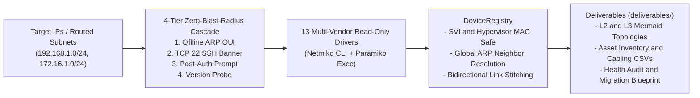

<!--
Copyright (C) 2026 Leif Davisson <leifdavisson@gmail.com>
SPDX-License-Identifier: AGPL-3.0-or-later
-->

# Net-Docu-Crawler

<p align="center">
  <a href="LICENSE">
    
  </a>
  <a href="https://www.python.org/">
    
  </a>
  <a href="https://github.com/ktbyers/netmiko">
    
  </a>
</p>

**Net-Docu-Crawler** is a zero-blast-radius, vendor-neutral network discovery, topology stitching, and documentation engine. It queries switches, routers, firewalls, wireless controllers/APs, and virtual routing daemons using strictly read-only operational state commands to produce authoritative Layer 1/2 cabling matrices, Layer 2 & Layer 3 Mermaid diagrams, asset inventories, and health audits.

---

## Architectural Highlights



* **4-Tier Pre-Identification Cascade**: Resolves hardware vendors offline via [`oui_lookup.py`](oui_lookup.py), automatically bypasses hypervisor virtual NIC OUIs (`BC:24:11` [Proxmox VE](https://www.proxmox.com/), `52:54:00` QEMU/KVM, VMware, VirtualBox, Hyper-V, Xen) so virtual appliances and targets behind L3 gateways (`172.16.1.0/24`) identify cleanly via pre-auth SSH banners and prompts.
* **3-Stage Legacy & Hardened SSH Compatibility Ladder**: [`ssh_compat.py`](net_docu_crawler/ssh_compat.py) negotiates modern hardened KEX (`curve25519-sha256`, `diffie-hellman-group18-sha512`) and automatically falls back across legacy `ssh-dss` ([pyca/cryptography](https://cryptography.io/) DSA SHA-1 verification) and `disable_sha2_fix` (`ssh-rsa` SHA-1) without failing on `IncompatiblePeer` errors.
* **AAA Anti-Lockout & Console-Menu Safety**: Sorts candidate credentials by detected OS before connecting, aborts socket timeouts immediately, and uses non-interactive [Paramiko](https://www.paramiko.org/) `exec_command` channels on [OPNsense](https://docs.opnsense.org/) to avoid interactive PTY menu traps.
* **Cross-Vendor Topology Stitching & Trunk VLAN Audit**: Deduplicates multi-SVI chassis without merging cloned VMs/containers, enriches MAC-only LLDP neighbors (such as wireless APs) via Global ARP tables, confirms bidirectional links across mixed vendors, and audits inter-switch trunk symmetry (`TRK-001`–`TRK-007`).

---

## Supported Platforms & Official Documentation

| Platform / OS | Driver | Transport | Official Reference |
| :--- | :--- | :--- | :--- |
| **Cisco IOS / IOS-XE / NX-OS** | [`CiscoDriver`](net_docu_crawler/drivers/cisco.py) | [Netmiko](https://github.com/ktbyers/netmiko) (`cisco_ios`) | [Cisco IOS & NX-OS Docs](https://www.cisco.com/c/en/us/support/ios-nx-os-software/index.html) |
| **Cisco IOS-XR (ASR 9000 / NCS / XRv)** | [`CiscoXRDriver`](net_docu_crawler/drivers/cisco_xr.py) | Netmiko (`cisco_xr`; optional NETCONF/gNMI) | [Cisco IOS-XR Docs](https://www.cisco.com/c/en/us/support/ios-nx-os-software/ios-xr-software/tsd-products-support-series-home.html) |
| **Cisco Small Business (SG250 / SG300 / SG350 / CBS350)** | [`CiscoSMBDriver`](net_docu_crawler/drivers/ciscosmb.py) | Netmiko (`cisco_s300`) | [Cisco SMB 300 Command Ref](https://www.cisco.com/c/en/us/support/switches/small-business-300-series-managed-switches/products-command-reference-list.html) |
| **Juniper Junos OS (EX / QFX / SRX / MX)** | [`JuniperDriver`](net_docu_crawler/drivers/juniper.py) | Netmiko (`juniper_junos` JSON) | [Juniper Junos Documentation](https://www.juniper.net/documentation/product/us/en/junos-os/) |
| **Arista EOS / vEOS** | [`AristaDriver`](net_docu_crawler/drivers/arista.py) | Netmiko (`arista_eos` JSON) | [Arista EOS User Manual](https://www.arista.com/en/um-eos) |
| **HP ProCurve / ArubaOS-S (Provision)** | [`HPProCurveDriver`](net_docu_crawler/drivers/hpprocurve.py) | Netmiko (`hp_procurve`) | [ArubaOS-S Documentation](https://www.arubanetworks.com/techdocs/AOS-S/16.10/MWG/content/home.htm) |
| **Aruba Instant / AOS-CX** | [`ArubaDriver`](net_docu_crawler/drivers/aruba.py) | Netmiko (`aruba_os` / AOS-CX) | [HPE Aruba AOS-CX Docs](https://www.arubanetworks.com/techdocs/AOS-CX/help_portal/Content/home.htm) / [Aruba Instant](https://www.arubanetworks.com/techdocs/ArubaDocPortal/content/cons-instant-home.htm) |
| **MikroTik RouterOS / CHR** | [`MikroTikDriver`](net_docu_crawler/drivers/mikrotik.py) | Netmiko (`mikrotik_routeros`) | [MikroTik RouterOS CLI Docs](https://help.mikrotik.com/docs/spaces/ROS/pages/8519681/Command+Line+Interface) |
| **Fortinet FortiOS (FortiGate)** | [`FortinetDriver`](net_docu_crawler/drivers/fortinet.py) | Read-only Netmiko (`ReadOnlyFortinetSSH`) | [FortiOS CLI Reference](https://docs.fortinet.com/document/fortigate/hardware/fortios-cli-reference) |
| **Palo Alto PAN-OS** | [`PaloAltoDriver`](net_docu_crawler/drivers/paloalto.py) | Netmiko (`paloalto_panos`) | [Palo Alto PAN-OS Docs](https://docs.paloaltonetworks.com/pan-os) |
| **OPNsense (FreeBSD)** | [`OPNsenseDriver`](net_docu_crawler/drivers/opnsense.py) | [Paramiko](https://www.paramiko.org/) (`exec_command`) | [OPNsense Documentation](https://docs.opnsense.org/) |
| **OpenWrt (`ubus` / `uci`)** | [`OpenWrtDriver`](net_docu_crawler/drivers/openwrt.py) | Netmiko (`linux` + `ubus` JSON) | [OpenWrt Documentation](https://openwrt.org/docs/start) |
| **FRRouting (`vtysh` on Linux/LXC)** | [`FRRDriver`](net_docu_crawler/drivers/frr.py) | Netmiko (`linux` + `vtysh -c`) | [FRRouting User Guide](https://docs.frrouting.org/) |

> **Note on Excluded Platforms:** Cloud-only controllers (Meraki, UniFi), web-only smart/unmanaged switches (including Cisco SG110/SG200/CBS110), ANSI menu-driven legacy gear, ISP-owned CPEs, and non-forwarding endpoints are intentionally documented passively (LLDP + ARP/OUI + HTTP/TLS + optional SNMP) rather than via CLI drivers. See [Driver Support Policy & Excluded Platforms](docs/drivers/overview.md#7-driver-support-policy--explicitly-excluded-platforms) for details.

---

## Quick Start

### 1. Install Dependencies

**Windows (fresh machine):** run the assessor from PowerShell in the project folder. It checks Python 3.10-3.12, Git, PATH, the x64 [VC++ Redistributable](https://learn.microsoft.com/cpp/windows/latest-supported-vc-redist), and installs dependencies into `.venv`. Use `-Fix` to repair (uses [winget](https://learn.microsoft.com/windows/package-manager/winget/)).

```powershell
powershell -ExecutionPolicy Bypass -File .\setup_windows.ps1        # assess only
powershell -ExecutionPolicy Bypass -File .\setup_windows.ps1 -Fix   # assess + fix
```

**Linux/macOS (recommended isolated `.venv`):**

```bash
python3 -m venv .venv
source .venv/bin/activate
pip install -e .          # runtime + `net-crawler` CLI (or `pip install -e ".[dev]"` for pytest/ruff/mypy)
cp credentials.example.json credentials.json
```

*(Runtime-only alternative without the `net-crawler` console script: `pip install -r requirements.txt`. For optional Cisco IOS-XR NETCONF/gNMI extras, run `pip install -e ".[xr]"`.)*

### 2. Run Discovery & Generate Documentation

```bash
# Auto-detect local subnet and crawl SSH (22) + Telnet (23) + HTTP/ARP inventory
python3 net_crawler.py

# Try vendor defaults first, then your site credentials
python3 net_crawler.py --credentials credentials.example.json credentials.json --organize

# Crawl specific hosts / custom ports (ip:port or --ssh-ports 22 2222) AND follow connected ARP-guided subnets
python3 net_crawler.py --targets 192.168.1.1 192.168.1.220:2222 --follow-subnets --organize

# Re-parse raw logs/*_raw_session.log offline through updated drivers, or regenerate reports from dataset JSON
python3 net_crawler.py --reparse-logs deliverables/<run_dir>/
python3 net_crawler.py --from-dataset deliverables/<run_dir>/net_docu_crawler_dataset.json

# Generate staged target-vendor migration configs + save/compare cutover baselines
python3 net_crawler.py --targets 192.168.1.0/24 --target-vendor juniper --save-baseline baseline.json --organize
python3 net_crawler.py --targets 192.168.1.0/24 --compare-baseline baseline.json --organize

# Opt-in read-only SNMPv2c enrichment for headless/unauthenticated devices
python3 net_crawler.py --snmp --snmp-community public --organize
```

---

## Generated Deliverables

When executed (organized into `deliverables/<Target>_<Timestamp>_<site>/` by default, or flat into `docs/net_docu_crawler/` with `--no-organize`), the crawler automatically builds an engineer-ready deliverable bundle:

1. **`Network_Analysis.md`** & **`cutover_runbook.md`**: Complete Network Migration Blueprint and phased cutover runbook tailored for network engineers (chassis migration, VLAN mappings, cabling schedules, routing and default gateway requirements, risk matrix).
2. **`asset_inventory.csv`**: Normalized infrastructure inventory (`Hostname`, `IP Address`, `MAC Address`, `Device Type`, `Model`, `Firmware`, `Serial Number`, `Role`, `Management Method`) for successfully authenticated network infrastructure. Unauthenticated, unsupported, and ARP-discovered hosts are tracked separately in `00_manifest/failures.csv` and `failed_hosts.json`.
3. **`bom_hardware_sizing.csv`**: Hardware sizing & Bill-of-Materials rollup (port counts, PoE wattage budgets/draw, SFP/SFP+/QSFP optics totals; defaults target SKU sizing to Juniper unless `--target-vendor` is set).
4. **`migration_cabling_matrix.csv`** & **`port_mac_endpoint_mapping.csv`**: Physical port-by-port patching matrix with link speeds, duplex, and LLDP/CDP neighbor mapping, plus switchport-to-MAC/OUI endpoint mapping.
5. **`L2_network_diagrams.md`** & **`topology_interactive.html`**: Interactive Mermaid physical switching diagram, self-contained HTML topology explorer, and Wireless Access Point overlay table.
6. **`L3_network_diagrams.md`**: Authoritative VLAN, CIDR subnet ([netaddr](https://netaddr.readthedocs.io/)), and SVI routing topology diagram.
7. **`net_docu_crawler_live_report.md`** & **`manual_followup_report.md`**: Layered L1–L7 network health analysis (interface utilization, STP root/blocking audit, CIDR conflict check, DNS/NTP/AAA posture, per-port L2 intent, trunk VLAN mismatch summary, routing peers/FHRP, DHCP, and PoE/optics sizing) plus actionable manual follow-up checklist.
8. **`trunk_vlan_audit.md`**, **`03_correlated/trunk_audit.json`**, & **`03_correlated/trunk_mismatches.csv`**: Dedicated cross-vendor Trunk VLAN Mismatch Detection report (`05_reports/trunk_vlan_audit.md` and top-level `trunk_vlan_audit.md`), structured edge audit JSON, and per-discrepancy remediation CSV (`TRK-001`–`TRK-007`, LAG aggregation, QinQ boundaries, and uncrawled/asymmetric neighbor flags).
9. **`cisco_to_target_translation.md`** *(and `target_migration_<vendor>.md` with `--target-vendor`)*: Cross-vendor configuration translation and staged target CLI.
10. **`net_docu_crawler_dataset.json`**, **`validate_cutover.sh`**, & **`failed_hosts.json`**: Canonical normalized JSON dataset (for `--from-dataset`), read-only post-cutover smoke test script, and unauthenticated/unsupported host log (for `--retry-failed`).
11. **Layered Subdirectories (`00_manifest/`, `01_raw/`, `02_normalized/`, `03_correlated/`, `04_migration/`, `05_reports/`) & `logs/`**: Machine-readable CSVs, `00_manifest/data_quality_report.md`, `00_manifest/collection_manifest.json`, `00_manifest/failures.csv`, `03_correlated/trunk_audit.json`, `03_correlated/trunk_mismatches.csv`, `05_reports/trunk_vlan_audit.md`, and complete operational/raw session logs.

---

## Documentation & Guides

* **[Junior Operator Playbook (Zero-Knowledge Beginner Guide)](docs/junior_operator_playbook.md)**: Beginner-friendly step-by-step walkthrough for technicians who only know basic IP concepts.
* **[Agent & Contributor Architecture Guide](AGENTS.md)**: Operational guardrails, zero-blast-radius rules, and code architecture.
* **[Model & Prompt Routing Strategy](docs/model_prompt_routing_strategy.md)**: [Google Gemini](https://ai.google.dev/gemini-api/docs/models) capability/cost routing matrix, thinking-level policy, quota fallback chains, and swarm task assignment.
* **[Driver Command Reference](docs/drivers/overview.md)**: Supported read-only CLI command matrices, 3-stage SSH compatibility ladder, and transport notes for all 13 supported network operating system drivers.
* **[Manual Page (`net-crawler(1)`)](docs/man/net-crawler.1.md)**: Full CLI reference.
* **[Virtual Lab & Driver Roadmap](docs/proxmox_lab_and_driver_roadmap.md)**: Architecture and setup for virtualized multi-vendor Proxmox VE testbeds.

---

## Verification & Development

* **Run Linter & Test Suite**:
  ```bash
  ruff check .
  pytest -v
  ```

---

## License

Licensed under the **GNU Affero General Public License v3.0 or later (`AGPL-3.0-or-later`)**. See [`LICENSE`](LICENSE) for full terms.
