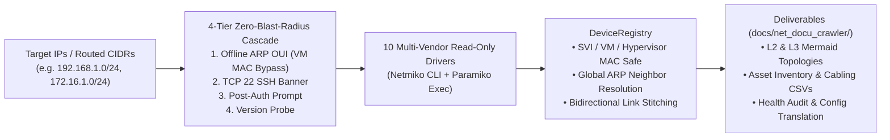

<!--
Copyright (C) 2026 Leif Davisson <leifdavisson@gmail.com>
SPDX-License-Identifier: AGPL-3.0-or-later
-->

# Net-Docu-Crawler

[Open README.md](README.md)

<p align="center">
  <a href="LICENSE">
    
  </a>
  <a href="https://www.python.org/">
    
  </a>
  <a href="https://github.com/ktbyers/netmiko">
    
  </a>
</p>

**Net-Docu-Crawler** is a zero-blast-radius, vendor-neutral network discovery, topology stitching, and documentation engine. It queries switches, routers, firewalls, wireless controllers/APs, and virtual routing daemons using strictly read-only operational state commands to produce authoritative Layer 1/2 cabling matrices, Layer 2 & Layer 3 Mermaid diagrams, asset inventories, and health audits.

---

## Architectural Highlights



* **4-Tier Pre-Identification Cascade**: Resolves hardware vendors offline via [`oui_lookup.py`](oui_lookup.py), automatically bypasses hypervisor virtual NIC OUIs (`BC:24:11` [Proxmox VE](https://www.proxmox.com/), `52:54:00` QEMU/KVM, VMware, VirtualBox, Hyper-V, Xen) so virtual appliances and targets behind L3 gateways (`172.16.1.0/24`) identify cleanly via pre-auth SSH banners and prompts.
* **AAA Anti-Lockout & Console-Menu Safety**: Sorts candidate credentials by detected OS before connecting, aborts socket timeouts immediately, and uses non-interactive [Paramiko](https://www.paramiko.org/) `exec_command` channels on [OPNsense](https://docs.opnsense.org/) to avoid interactive PTY menu traps.
* **Cross-Vendor Topology Stitching**: Deduplicates multi-SVI chassis without merging cloned VMs/containers, enriches MAC-only LLDP neighbors (such as wireless APs) via Global ARP tables, and confirms bidirectional links across mixed vendors.

---

## Supported Platforms & Official Documentation

| Platform / OS | Driver | Transport | Official Reference |
| :--- | :--- | :--- | :--- |
| **Cisco IOS / IOS-XE / NX-OS / IOS-XR** | [`CiscoDriver`](net_docu_crawler/drivers/cisco.py) | [Netmiko](https://github.com/ktbyers/netmiko) (`cisco_ios`) | [Cisco IOS & NX-OS Docs](https://www.cisco.com/c/en/us/support/ios-nx-os-software/index.html) |
| **Juniper Junos OS (EX / QFX / SRX / MX)** | [`JuniperDriver`](net_docu_crawler/drivers/juniper.py) | Netmiko (`juniper_junos` JSON) | [Juniper Junos Documentation](https://www.juniper.net/documentation/product/us/en/junos-os/) |
| **Arista EOS / vEOS** | [`AristaDriver`](net_docu_crawler/drivers/arista.py) | Netmiko (`arista_eos` JSON) | [Arista EOS User Manual](https://www.arista.com/en/um-eos) |
| **Aruba Instant / AOS-CX** | [`ArubaDriver`](net_docu_crawler/drivers/aruba.py) | Netmiko (`aruba_osswitch`) | [HPE Aruba Networking Portal](https://www.arubanetworks.com/techdocs/ArubaDocPortal/content/cons-instant-home.htm) |
| **MikroTik RouterOS / CHR** | [`MikroTikDriver`](net_docu_crawler/drivers/mikrotik.py) | Netmiko (`mikrotik_routeros`) | [MikroTik RouterOS CLI Docs](https://help.mikrotik.com/docs/spaces/ROS/pages/8519681/Command+Line+Interface) |
| **Fortinet FortiOS (FortiGate)** | [`FortinetDriver`](net_docu_crawler/drivers/fortinet.py) | Netmiko (`fortinet`) | [FortiOS CLI Reference](https://docs.fortinet.com/document/fortigate/hardware/fortios-cli-reference) |
| **Palo Alto PAN-OS** | [`PaloAltoDriver`](net_docu_crawler/drivers/paloalto.py) | Netmiko (`paloalto_panos`) | [Palo Alto PAN-OS Docs](https://docs.paloaltonetworks.com/pan-os) |
| **OPNsense (FreeBSD)** | [`OPNsenseDriver`](net_docu_crawler/drivers/opnsense.py) | [Paramiko](https://www.paramiko.org/) (`exec_command`) | [OPNsense Documentation](https://docs.opnsense.org/) |
| **OpenWrt (`ubus` / `uci`)** | [`OpenWrtDriver`](net_docu_crawler/drivers/openwrt.py) | Netmiko (`linux` + `ubus` JSON) | [OpenWrt Documentation](https://openwrt.org/docs/start) |
| **FRRouting (`vtysh` on Linux/LXC)** | [`FRRDriver`](net_docu_crawler/drivers/frr.py) | Netmiko (`linux` + `vtysh -c`) | [FRRouting User Guide](https://docs.frrouting.org/) |

---

## Quick Start

### 1. Install Dependencies

```bash
pip install -e ".[dev]"
cp credentials.example.json credentials.json
```

### 2. Run Discovery & Generate Documentation

```bash
# Crawl default target list into docs/net_docu_crawler/
python3 net_crawler.py

# Crawl specific hosts AND routed subnets across a gateway (TCP 22 pre-filtered)
python3 net_crawler.py --targets 192.168.1.1 192.168.1.3 172.16.1.0/24

# Custom output directory
python3 net_crawler.py --targets 10.10.20.0/24 --output-dir deliverables/site_a
```

---

## Generated Deliverables (`docs/net_docu_crawler/`)

1. **`asset_inventory.csv`**: Normalized inventory (Hostname, IP, MAC, Vendor, Persona, Model, Firmware, Serial).
2. **`migration_cabling_matrix.csv`**: Physical port-by-port patching matrix with link speeds, duplex, and LLDP/CDP neighbor mapping.
3. **`L2_network_diagrams.md`**: Interactive Mermaid physical switching diagram + Wireless Access Point overlay table.
4. **`L3_network_diagrams.md`**: Authoritative VLAN, CIDR subnet ([netaddr](https://netaddr.readthedocs.io/)), and SVI routing topology diagram.
5. **`net_docu_crawler_live_report.md`**: Layered L1–L7 network health analysis (interface utilization, STP root/blocking audit, CIDR conflict check, DNS/NTP/AAA posture).
6. **`cisco_to_target_translation.md`**: Cross-vendor configuration translation reference.

---

## Verification & Development

* **Agent & Contributor Architecture Guide**: [Open AGENTS.md](AGENTS.md)
* **Driver Command Reference**: [Open overview.md](docs/drivers/overview.md)
* **Run Linter & Test Suite**:
  ```bash
  ruff check .
  pytest -v
  ```

---

## License

Licensed under the **GNU Affero General Public License v3.0 or later (`AGPL-3.0-or-later`)**. See [`LICENSE`](LICENSE) for full terms.
