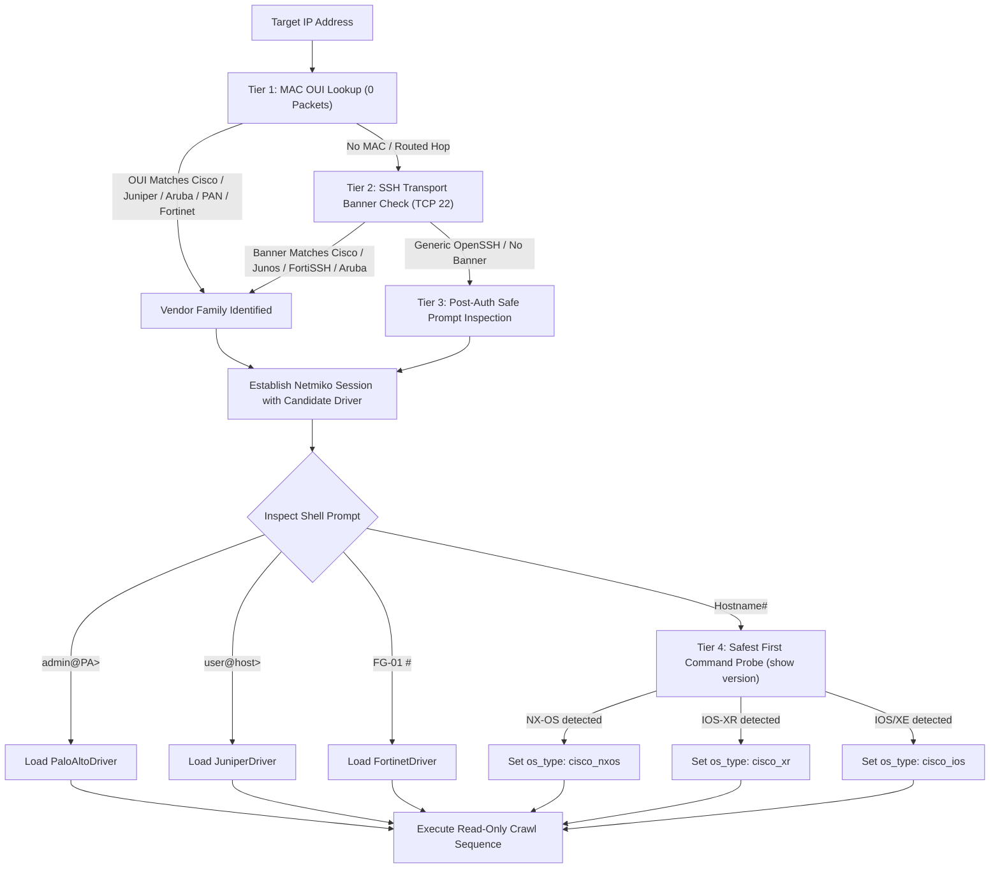

<!--
Copyright (C) 2026 Leif Davisson <leifdavisson@gmail.com>

This program is free software: you can redistribute it and/or modify
it under the terms of the GNU Affero General Public License as published by
the Free Software Foundation, either version 3 of the License, or
(at your option) any later version.

This program is distributed in the hope that it will be useful,
but WITHOUT ANY WARRANTY; without even the implied warranty of
MERCHANTABILITY or FITNESS FOR A PARTICULAR PURPOSE.  See the
GNU Affero General Public License for more details.

You should have received a copy of the GNU Affero General Public License
along with this program.  If not, see <https://www.gnu.org/licenses/>.
-->

# Net-Docu-Crawler: Multi-Vendor Driver Architecture Overview

Welcome to the **Net-Docu-Crawler** driver subsystem. This document outlines the unified multi-vendor driver model, pre-authentication fingerprinting cascade, device personas, and pagination safety mechanics.

---

## 1. Project Unification Notice

**Net-Docu-Crawler** is the consolidated successor to the legacy single-vendor projects:
* `Cisco-Docu-Crawler` (Deprecated)
* `Juniper-Docu-Crawler` (Deprecated)

Rather than maintaining separate network crawlers for each hardware vendor, **Net-Docu-Crawler** provides a single modular architecture supporting Cisco, Juniper, Aruba, Palo Alto Networks, and Fortinet within a unified execution engine.

---

## 2. Vendor Comparison Matrix

| Platform | Primary OS Families | Personas Supported | Paging Disable Command | Structured Output Native? | Default Device Type |
| :--- | :--- | :--- | :--- | :--- | :--- |
| [**Cisco Systems**](cisco.md) | IOS, IOS-XE, NX-OS, IOS-XR | Switch, Router | `terminal length 0` | Regex Parsing / TextFSM | [`CiscoDriver`](../../net_docu_crawler/drivers/cisco.py) |
| [**Juniper Networks**](juniper.md) | JunOS (EX, QFX, MX, SRX) | Switch, Router, Firewall | `set cli screen-length 0` | Native JSON (`\| display json`) | [`JuniperDriver`](../../net_docu_crawler/drivers/juniper.py) |
| [**Aruba / HPE**](aruba.md) | ArubaOS (IAP), AOS-CX, ProCurve | Access Point, Switch | `no page` | Regex Parsing | [`ArubaDriver`](../../net_docu_crawler/drivers/aruba.py) |
| [**Palo Alto Networks**](paloalto.md) | PAN-OS (PA-Series, Panorama) | Firewall | `set cli pager off` | Tabular / XML / CLI | [`PaloAltoDriver`](../../net_docu_crawler/drivers/paloalto.py) |
| [**Fortinet**](fortinet.md) | FortiOS (FortiGate) | Firewall | `config system console` `set output standard` `end` | Tabular / CMDB | [`FortinetDriver`](../../net_docu_crawler/drivers/fortinet.py) |
| [**Arista Networks**](arista.md) | EOS (vEOS, cEOS, Fixed) | Switch, Router | Native JSON | Native JSON (`\| json`) | [`AristaDriver`](../../net_docu_crawler/drivers/arista.py) |
| [**MikroTik**](mikrotik.md) | RouterOS v6 / v7 (CHR, RB) | Router, Switch | `without-paging` | Key-value pairs (`detail`) | [`MikroTikDriver`](../../net_docu_crawler/drivers/mikrotik.py) |
| [**FRRouting (FRR)**](frr.md) | Linux Daemons (Debian/Ubuntu) | Router, Gateway | Native CLI | Native JSON (`show ... json`) | [`FRRDriver`](../../net_docu_crawler/drivers/frr.py) |
| [**OPNsense**](opnsense.md) | FreeBSD Firewall / Gateway | Firewall, Gateway | Non-interactive exec | XML / POSIX | [`OPNsenseDriver`](../../net_docu_crawler/drivers/opnsense.py) |
| [**OpenWrt**](openwrt.md) | Embedded Linux (ARM/MIPS/x86) | Router, Gateway, AP | Non-interactive / POSIX | Native JSON (`ubus`) / UCI | [`OpenWrtDriver`](../../net_docu_crawler/drivers/openwrt.py) |

---

## 3. The 4-Tier Zero-Blast-Radius Pre-Check Cascade

Sending the wrong command to the wrong switch CLI is hazardous. For example, sending Cisco's `terminal length 0` to a Juniper switch generates a syntax error, leaving pagination active. When the crawler subsequently issues `show configuration`, the session hangs on `--More--` until timing out, locking up a switch VTY line.

To guarantee zero blast radius, Net-Docu-Crawler enforces a 4-tier identification cascade implemented in [`net_docu_crawler/drivers/detector.py`](../../net_docu_crawler/drivers/detector.py):

---

## 4. Device Personas & Data Modeling

Net-Docu-Crawler segregates discovery data based on **Device Personas**:

1. **`switch`**:
   - Focus: VLAN database, Spanning Tree (STP) root bridges, physical switchports (access/trunk/PoE), MAC address learning tables, and LLDP/CDP neighbor graphs.
2. **`firewall`**:
   - Focus: Security Zones, Virtual Routers (VRs), NAT rules, management access, SVI interfaces, and ARP gateway tables. Traditional switchport and STP commands are omitted.
3. **`ap` (Access Point)**:
   - Focus: Master/Slave cluster topology, active SSIDs, 2.4/5/6 GHz radio channels, BSSID mapping, connected client counts, and PoE uplink negotiation.
4. **`router`**:
   - Focus: Layer 3 interfaces, VRFs, routing tables (BGP/OSPF/EIGRP/Static), and next-hop reachability.

---

## 5. Official Documentation Links & References

- **[Netmiko Multi-Vendor Network Automation Library](https://github.com/ktbyers/netmiko)**
- **[Paramiko Python SSH Library](https://www.paramiko.org/)**
- **[Cisco IOS Software Configuration Guide](https://www.cisco.com/c/en/us/support/ios-nx-os-software/index.html)**
- **[Juniper JunOS Automation & CLI Documentation](https://www.juniper.net/documentation/us/en/software/junos/automation-scripting/)**
- **[ArubaOS-CX CLI Reference Guide](https://www.arubanetworks.com/techdocs/AOS-CX/)**
- **[Palo Alto Networks PAN-OS CLI Reference](https://docs.paloaltonetworks.com/pan-os)**
- **[Fortinet FortiOS CLI Reference](https://docs.fortinet.com/document/fortigate/hardware/fortios-cli-reference)**
- **[Arista EOS Central & Documentation](https://www.arista.com/en/support/product-documentation)**
- **[MikroTik RouterOS v7 Documentation](https://help.mikrotik.com/docs/)**
- **[FRRouting Official Documentation](https://docs.frrouting.org/)**
- **[OPNsense Official Documentation](https://docs.opnsense.org/)**
- **[OpenWrt Official Documentation & User Guide](https://openwrt.org/docs/start)**
