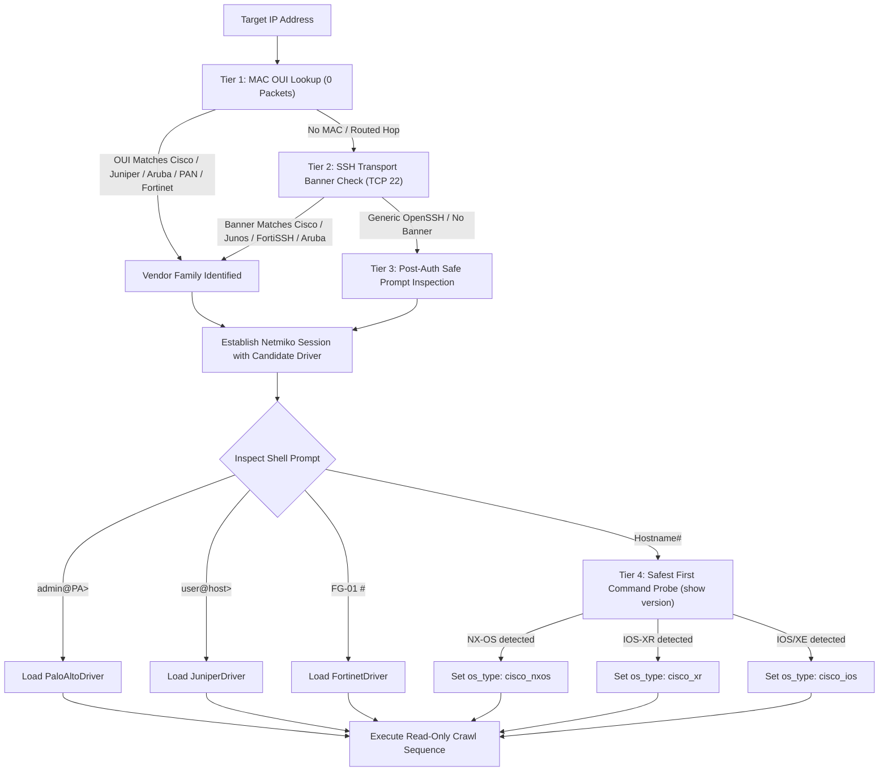

<!--
Copyright (C) 2026 Leif Davisson <leifdavisson@gmail.com>
SPDX-License-Identifier: AGPL-3.0-or-later

This program is free software: you can redistribute it and/or modify
it under the terms of the GNU Affero General Public License as published by
the Free Software Foundation, either version 3 of the License, or
(at your option) any later version.

This program is distributed in the hope that it will be useful,
but WITHOUT ANY WARRANTY; without even the implied warranty of
MERCHANTABILITY or FITNESS FOR A PARTICULAR PURPOSE.  See the
GNU Affero General Public License for more details.

You should have received a copy of the GNU Affero General Public License
along with this program.  If not, see <https://www.gnu.org/licenses/>.
-->

# Net-Docu-Crawler: Multi-Vendor Driver Architecture Overview

Welcome to the **Net-Docu-Crawler** driver subsystem. This document outlines the unified multi-vendor driver model, pre-authentication fingerprinting cascade, device personas, and pagination safety mechanics.

---

## 1. Project Unification Notice

**Net-Docu-Crawler** is the consolidated successor to the legacy single-vendor projects:
* `Cisco-Docu-Crawler` (Deprecated)
* `Juniper-Docu-Crawler` (Deprecated)

Rather than maintaining separate network crawlers for each hardware vendor, **Net-Docu-Crawler** provides a single modular architecture supporting Cisco, Juniper, Aruba, Palo Alto Networks, and Fortinet within a unified execution engine.

---

## 2. Vendor Comparison Matrix

| Platform | Primary OS Families | Personas Supported | Paging Disable Command | Structured Output Native? | Default Device Type |
| :--- | :--- | :--- | :--- | :--- | :--- |
| [**Cisco Systems**](cisco.md) | IOS, IOS-XE, NX-OS, IOS-XR | Switch, Router | `terminal length 0` | Regex Parsing / TextFSM | [`CiscoDriver`](../../net_docu_crawler/drivers/cisco.py) |
| [**Cisco Small Business**](ciscosmb.md) | SG250/SG300/SG350/SG500/CBS250/CBS350 | Switch | `terminal datadump` | Regex Parsing | [`CiscoSMBDriver`](../../net_docu_crawler/drivers/ciscosmb.py) |
| [**Juniper Networks**](juniper.md) | JunOS (EX, QFX, MX, SRX) | Switch, Router, Firewall | `set cli screen-length 0` | Native JSON (`\| display json`) | [`JuniperDriver`](../../net_docu_crawler/drivers/juniper.py) |
| [**HP ProCurve / ArubaOS-S**](hpprocurve.md) | Provision / ArubaOS-S 14.x-16.x | Switch | `no page` | Regex Parsing / Fixed-width | [`HPProCurveDriver`](../../net_docu_crawler/drivers/hpprocurve.py) |
| [**Aruba / HPE**](aruba.md) | ArubaOS (IAP), AOS-CX | Access Point, Switch | `no page` | Regex / CLI Parsing | [`ArubaDriver`](../../net_docu_crawler/drivers/aruba.py) |
| [**Palo Alto Networks**](paloalto.md) | PAN-OS (PA-Series, Panorama) | Firewall | `set cli pager off` | Tabular / XML / CLI | [`PaloAltoDriver`](../../net_docu_crawler/drivers/paloalto.py) |
| [**Fortinet**](fortinet.md) | FortiOS (FortiGate) | Firewall | `config system console` `set output standard` `end` | Tabular / CMDB | [`FortinetDriver`](../../net_docu_crawler/drivers/fortinet.py) |
| [**Arista Networks**](arista.md) | EOS (vEOS, cEOS, Fixed) | Switch, Router | Native JSON | Native JSON (`\| json`) | [`AristaDriver`](../../net_docu_crawler/drivers/arista.py) |
| [**MikroTik**](mikrotik.md) | RouterOS v6 / v7 (CHR, RB) | Router, Switch | `without-paging` | Key-value pairs (`detail`) | [`MikroTikDriver`](../../net_docu_crawler/drivers/mikrotik.py) |
| [**FRRouting (FRR)**](frr.md) | Linux Daemons (Debian/Ubuntu) | Router, Gateway | Native CLI | Native JSON (`show ... json`) | [`FRRDriver`](../../net_docu_crawler/drivers/frr.py) |
| [**OPNsense**](opnsense.md) | FreeBSD Firewall / Gateway | Firewall, Gateway | Non-interactive exec | XML / POSIX | [`OPNsenseDriver`](../../net_docu_crawler/drivers/opnsense.py) |
| [**OpenWrt**](openwrt.md) | Embedded Linux (ARM/MIPS/x86) | Router, Gateway, AP | Non-interactive / POSIX | Native JSON (`ubus`) / UCI | [`OpenWrtDriver`](../../net_docu_crawler/drivers/openwrt.py) |

---

## 3. The 4-Tier Zero-Blast-Radius Pre-Check Cascade

Sending the wrong command to the wrong switch CLI is hazardous. For example, sending Cisco's `terminal length 0` to a Juniper switch generates a syntax error, leaving pagination active. When the crawler subsequently issues `show configuration`, the session hangs on `--More--` until timing out, locking up a switch VTY line.

To guarantee zero blast radius, Net-Docu-Crawler enforces a 4-tier identification cascade implemented in [`net_docu_crawler/drivers/detector.py`](../../net_docu_crawler/drivers/detector.py):

---

## 4. Device Personas & Data Modeling

Net-Docu-Crawler segregates discovery data based on **Device Personas**:

1. **`switch`**:
   - Focus: VLAN database, Spanning Tree (STP) root bridges, physical switchports (access/trunk/PoE), MAC address learning tables, and LLDP/CDP neighbor graphs.
2. **`firewall`**:
   - Focus: Security Zones, Virtual Routers (VRs), NAT rules, management access, SVI interfaces, and ARP gateway tables. Traditional switchport and STP commands are omitted.
3. **`ap` (Access Point)**:
   - Focus: Master/Slave cluster topology, active SSIDs, 2.4/5/6 GHz radio channels, BSSID mapping, connected client counts, and PoE uplink negotiation.
4. **`router`**:
   - Focus: Layer 3 interfaces, VRFs, routing tables (BGP/OSPF/EIGRP/Static), and next-hop reachability.

---

## 5. 3-Stage SSH Compatibility Ladder (`ssh_compat.py`)

Both modern hardened SSH servers and decades-old embedded switch daemons (Mocana SSH, early IOS/Junos) can reject default [Paramiko](https://www.paramiko.org/) / [Netmiko](https://github.com/ktbyers/netmiko) handshakes with `IncompatiblePeer` (`no acceptable kex algorithm` or `no acceptable host key`). [`net_docu_crawler/ssh_compat.py`](../../net_docu_crawler/ssh_compat.py) resolves this transparently via `BaseDriver.safe_netmiko_connect()` and `OPNsenseDriver.connect()` (`connect_netmiko_with_fallback` and `connect_paramiko_with_fallback`):

1. **Pre-Negotiation Hardened KEX Registration (`configure_paramiko_compat(enable_legacy_dss=False)`)**:
   - Silences `paramiko` and `paramiko.transport` loggers to `CRITICAL` so background-thread handshake retries do not emit noisy tracebacks.
   - Registers RFC 8731 `curve25519-sha256` (`KexCurve25519`, when available) and RFC 3526 `diffie-hellman-group18-sha512` (8192-bit MODP Group 18 via `KexGroup18SHA512`) into `paramiko.Transport._kex_info` and `_preferred_kex`.
2. **Stage 1 — Standard + Hardened KEX**:
   - Attempts a normal [Netmiko](https://github.com/ktbyers/netmiko) `ConnectHandler` (or [Paramiko](https://www.paramiko.org/) `SSHClient.connect` for [OPNsense](https://docs.opnsense.org/)) session with modern KEX algorithms active and legacy `ssh-dss` disabled.
3. **Stage 2 — Legacy KEX, Ciphers, MACs & `LegacyDSSKey` (`ssh-dss`) with RSA-SHA2 Enabled**:
   - Triggered only on `is_ssh_negotiation_error()` (never on authentication failures or TCP timeouts).
   - Calls `configure_paramiko_compat(enable_legacy_dss=True)` to register read-only `LegacyDSSKey` (`ssh-dss`, backed by [pyca/cryptography](https://cryptography.io/) DSA + SHA-1 signature verification) and ensure legacy KEX (`diffie-hellman-group14-sha1`, `diffie-hellman-group-exchange-sha1`, `diffie-hellman-group1-sha1`), CBC ciphers (`aes128-cbc`, `aes192-cbc`, `aes256-cbc`, `3des-cbc`), and legacy MACs (`hmac-sha1`, `hmac-md5`, `hmac-sha1-96`, `hmac-md5-96`) are permitted.
   - Retries with `disabled_algorithms={}`, `disable_sha2_fix=False`, `ssh_strict=False` so `rsa-sha2-256` and `rsa-sha2-512` remain enabled.
4. **Stage 3 — `disable_sha2_fix=True` (`ssh-rsa` SHA-1 Fallback)**:
   - If Stage 2 still raises an SSH negotiation error, retries with `disabled_algorithms={}`, `disable_sha2_fix=True`, `ssh_strict=False` on Netmiko (or `disabled_algorithms={"pubkeys": ["rsa-sha2-256", "rsa-sha2-512"]}` on Paramiko) to support legacy peers that reject RFC 8332 `rsa-sha2-*` pubkey algorithms.

---

## 6. Read-Only L2 Trunk & LAG Operational Telemetry

To power cross-vendor **Trunk VLAN Mismatch Detection** ([`net_docu_crawler/trunk_audit.py`](../../net_docu_crawler/trunk_audit.py)) alongside [netaddr](https://netaddr.readthedocs.io/) L3 verification, switching drivers implement `get_l2_operational(conn)` using strictly read-only `show` commands:

| Platform | Read-Only Trunk Operational Command(s) | Read-Only LAG / STP / Auth Commands | Driver |
| :--- | :--- | :--- | :--- |
| **Cisco IOS / IOS-XE / NX-OS** | `show interfaces trunk` | `show etherchannel summary` | [`CiscoDriver`](../../net_docu_crawler/drivers/cisco.py) |
| **Juniper Junos OS** | `show ethernet-switching interfaces \| display json` *(text fallback)* | `show lacp interfaces \| display json`, `show spanning-tree interface \| display json` | [`JuniperDriver`](../../net_docu_crawler/drivers/juniper.py) |
| **HPE Aruba AOS-CX** | `show interface trunk` | `show lacp interfaces` | [`ArubaDriver`](../../net_docu_crawler/drivers/aruba.py) |
| **HP ProCurve / ArubaOS-S** | `show trunks` | `show lacp`, `show spanning-tree detail`, `show port-access authenticator` | [`HPProCurveDriver`](../../net_docu_crawler/drivers/hpprocurve.py) |
| **Arista EOS** | `show interfaces trunk \| json` *(text fallback)* | `show port-channel summary \| json` *(text fallback)* | [`AristaDriver`](../../net_docu_crawler/drivers/arista.py) |

All drivers preserve real physical/logical interface names inside `device_data["port_profiles"]` (never injecting synthetic metadata keys) so [`trunk_audit.py`](../../net_docu_crawler/trunk_audit.py) can collapse LAG members onto logical bundles (`Port-channel*`, `ae*`, `Trk*`, `lag*`) and evaluate `TRK-001`–`TRK-007` across mixed-vendor switch links.

---

## 7. Driver Support Policy & Explicitly Excluded Platforms

To preserve **zero blast radius** and truthful, low-maintenance discovery, **Net-Docu-Crawler** only implements CLI/API drivers for platforms that meet all three criteria:
1. Expose a **documented, non-interactive read-only CLI or local structured API** (SSH, Telnet, or local REST/XML/JSON).
2. Possess **L2/L3 forwarding, routing, or security-policy authority** needed for network documentation and vendor migrations.
3. Guarantee **zero-blast-radius** safety (no fragile VT100/ANSI menu traps, no cloud SaaS controller dependency, no ISP-owned demarcation gear).

### Explicitly Excluded Categories (Documented Passively Instead)

Hosts in these categories are intentionally **not** assigned CLI drivers. Instead, they are documented passively via upstream switch LLDP/CDP, `/proc/net/arp` + OUI lookup, HTTP/HTTPS banner & TLS certificate fingerprinting, and opt-in read-only SNMP (`--snmp`) in `asset_inventory.csv` and `port_mac_endpoint_mapping.csv`:

- **Cloud-Only / Controller-Locked Platforms** *(Cisco Meraki, controller-managed Ubiquiti UniFi, Aruba Instant On, TP-Link Omada Cloud)*: No stable local read-only CLI; full extraction requires SaaS cloud API keys and outbound internet access.
- **Web-Only "Smart" & Unmanaged Switches / Consumer ISP Combos** *(Netgear Plus/Smart web-only, D-Link EasySmart, unmanaged TP-Link, ISP-locked Arris/Sagemcom/Technicolor)*: No SSH/Telnet CLI; only proprietary HTML/CGI web forms without read-only separation.
- **ANSI / VT100 Menu-Driven Legacy Gear** *(3Com SuperStack, Nortel/Avaya BayStack menu-driven Telnet, pre-IOS CatOS)*: Cursor-driven Telnet menus are brittle under automated Expect/Netmiko sessions and risk accidental configuration/reboot navigation.
- **Carrier-Managed CPEs / ISP NIDs** *(ISP-owned Ciena, Adtran, Rad demarcation units)*: Belong to the upstream carrier; `--follow-subnets` documents the WAN interface on your own edge router/firewall and prunes at the RFC 1918 boundary unless explicitly overridden (`--allow-cgnat` / `--allow-public-subnets`).
- **Non-Forwarding Endpoint & Infrastructure Appliances** *(Printers, IP cameras, VoIP phones, NAS, UPS/PDU, server BMCs iDRAC/iLO/IPMI)*: Not switching/routing infrastructure; credential probing risks lockouts or SIEM alerts.

> [!NOTE]
> **Cisco Small Business Switches (`SG250` / `SG300` / `SG350` / `CBS250` / `CBS350`)**: CLI-capable managed models are supported via [`CiscoSMBDriver`](../../net_docu_crawler/drivers/ciscosmb.py) (`cisco_s300`). Web-only / unmanaged SMB models (`SG110`/`SG200`/`CBS110`) remain under the excluded web-only category above.

---

## 8. Official Documentation Links & References

- **[Netmiko Multi-Vendor Network Automation Library](https://github.com/ktbyers/netmiko)**
- **[Paramiko Python SSH Library](https://www.paramiko.org/)**
- **[pyca/cryptography Python Library](https://cryptography.io/)**
- **[netaddr Python Network Address Library](https://netaddr.readthedocs.io/)**
- **[Cisco IOS Software Configuration Guide](https://www.cisco.com/c/en/us/support/ios-nx-os-software/index.html)**
- **[Juniper JunOS Automation & CLI Documentation](https://www.juniper.net/documentation/product/us/en/junos-os/)**
- **[HPE Aruba AOS-CX Documentation Portal](https://www.arubanetworks.com/techdocs/AOS-CX/help_portal/Content/home.htm)**
- **[HPE ArubaOS-S 16.10 Management & Configuration Guide](https://www.arubanetworks.com/techdocs/AOS-S/16.10/MWG/content/home.htm)**
- **[Palo Alto Networks PAN-OS CLI Reference](https://docs.paloaltonetworks.com/pan-os)**
- **[Fortinet FortiOS CLI Reference](https://docs.fortinet.com/document/fortigate/hardware/fortios-cli-reference)**
- **[Arista EOS User Manual](https://www.arista.com/en/um-eos)**
- **[MikroTik RouterOS v7 Documentation](https://help.mikrotik.com/docs/)**
- **[FRRouting Official Documentation](https://docs.frrouting.org/)**
- **[OPNsense Official Documentation](https://docs.opnsense.org/)**
- **[OpenWrt Official Documentation & User Guide](https://openwrt.org/docs/start)**
