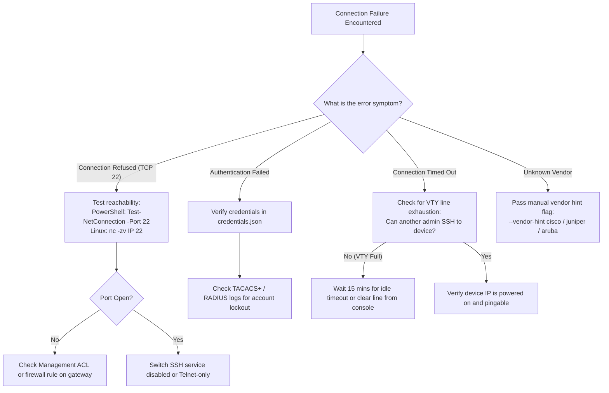

<!--
Copyright (C) 2026 Leif Davisson <leifdavisson@gmail.com>

This program is free software: you can redistribute it and/or modify
it under the terms of the GNU Affero General Public License as published by
the Free Software Foundation, either version 3 of the License, or
(at your option) any later version.

This program is distributed in the hope that it will be useful,
but WITHOUT ANY WARRANTY; without even the implied warranty of
MERCHANTABILITY or FITNESS FOR A PARTICULAR PURPOSE.  See the
GNU Affero General Public License for more details.

You should have received a copy of the GNU Affero General Public License
along with this program.  If not, see <https://www.gnu.org/licenses/>.
-->

# Net-Docu-Crawler: Junior Operator Playbook

Welcome to **Net-Docu-Crawler**! This operational playbook is designed for field technicians, helpdesk staff, and junior network operators. Even if you have **never written a line of Python** and only know basic concepts (like what an IP address is), this guide will walk you through discovering your network, generating cabling spreadsheets, and troubleshooting issues safely.

---

## Part 1: Zero-Knowledge Quick Start (Start Here!)

### 1. What Does Net-Docu-Crawler Do?

Think of Net-Docu-Crawler as an automated, polite, read-only network detective:
* It connects to your switches, routers, and firewalls over SSH.
* It asks them standard read-only questions (like *"What devices are plugged into your ports?"* and *"What IP addresses do you have?"*).
* It compiles the answers into **Excel-compatible spreadsheets (`.csv`)** and **visual network diagrams (`.md`)**.
* **Zero Blast Radius**: It **NEVER changes any configurations, reboots devices, or modifies settings**. It is 100% safe to run in production environments.

---

### 2. Step 1: Check If Python Is Installed

Net-Docu-Crawler runs on Python (version 3.10 or newer).

#### On Windows:
1. Press the Windows key + `R` on your keyboard, type `powershell`, and press **Enter**.
2. Type the following and press Enter:
   ```powershell
   python --version
   ```
3. If it says `Python 3.10.x` (or 3.11, 3.12, 3.13), you are ready!
4. If it opens the Microsoft Store or says `command not found`:
   - Download the latest Python installer from [python.org](https://www.python.org/downloads/).
   - **Crucial**: During installation, check the box that says **"Add python.exe to PATH"** before clicking Install.

#### On Linux or macOS:
1. Open your Terminal app.
2. Run:
   ```bash
   python3 --version
   ```
3. If not installed:
   - Ubuntu/Debian: `sudo apt update && sudo apt install -y python3 python3-pip git`
   - macOS: Install Homebrew from [brew.sh](https://brew.sh) and run `brew install python`.

---

### 3. Step 2: Download the Project and Install Dependencies

In PowerShell or Terminal, run these three commands:

```bash
# 1. Clone the repository
git clone https://github.com/leifdavisson/net-docu-crawler.git

# 2. Enter the project folder
cd net-docu-crawler

# 3. Install required libraries
pip install -r requirements.txt
```

---

### 4. Step 3: Configure Your Device Logins (`credentials.json`)

To log into your network switches, the crawler needs your management credentials.

1. Make a copy of the example credentials file:
   * **Windows PowerShell**:
     ```powershell
     Copy-Item credentials.example.json credentials.json
     notepad credentials.json
     ```
   * **Linux / macOS**:
     ```bash
     cp credentials.example.json credentials.json
     nano credentials.json
     ```
2. You will see a list of login entries. Update them with the username and password used to manage your network hardware:
   ```json
   [
     {
       "username": "admin",
       "password": "YourSecureSwitchPasswordHere",
       "enable_secret": ""
     }
   ]
   ```
   * **`username`**: The SSH username you use to log into your switches.
   * **`password`**: The password for that username.
   * **`enable_secret`**: The Cisco enable password (leave as `""` if not using Cisco enable mode).
   * **Security note**: `credentials.json` is automatically ignored by Git (`.gitignore`) so your passwords will never be committed or uploaded anywhere.

---

### 5. Step 4: Run the Discovery!

Now you are ready to crawl! Provide the IP address of your core switch, gateway, or a list of switches:

#### Crawl a Single Switch or Gateway:
```bash
python net_crawler.py --targets 192.168.1.1 --organize
```

#### Crawl Multiple Switches:
```bash
python net_crawler.py --targets 192.168.1.1 192.168.1.2 192.168.1.3 --organize
```

#### Crawl an Entire Subnet (automatically scans active management IPs):
```bash
python net_crawler.py --targets 192.168.1.0/24 --organize
```

*(Note: On Linux or macOS, use `python3 net_crawler.py ...` if `python` points to an older version).*

---

### 6. Step 5: Where Are My Results and How Do I Open Them?

When running with `--organize`, all deliverables are saved into an organized, timestamped folder under `docs/reports/`:
```text
docs/reports/192.168.1.0-24_20261108_143000_lan/
├── Network_Analysis.md
├── asset_inventory.csv
├── migration_cabling_matrix.csv
├── L2_network_diagrams.md
├── L3_network_diagrams.md
├── net_docu_crawler_live_report.md
├── cisco_to_target_translation.md
└── logs/
```

Here is how to view them:

| File Name | What It Is | How to Open It |
| :--- | :--- | :--- |
| **`asset_inventory.csv`** | Hardware list (Hostnames, IPs, MAC addresses, Models, Serials, Firmware versions). | Double-click to open in **Microsoft Excel**, LibreOffice Calc, or Google Sheets. |
| **`migration_cabling_matrix.csv`** | Port-by-port cabling schedule (what device and port connects to each switch port, speeds, duplex). | Double-click to open in **Microsoft Excel**. Perfect for physical rack cabling! |
| **`Network_Analysis.md`** | Complete migration blueprint with pre-migration checklists, VLAN tables, and risk matrix. | Open in **Typora**, **VS Code** (Markdown preview `Ctrl+Shift+V`), or any browser. |
| **`L2_network_diagrams.md`** | Interactive physical switching diagram and Wireless AP table. | Open in **Typora** or preview in GitHub/VS Code to view the interactive diagram. |
| **`L3_network_diagrams.md`** | Subnet, CIDR, and routing gateway diagram. | Open in **Typora** or VS Code. |
| **`logs/`** | Audit trail recording every step the crawler took. | Open `.log` files in Notepad or text editor for troubleshooting. |

---

## Part 2: Plain-English Troubleshooting Guide

When a connection fails, check the error message in your terminal and follow these steps:

### 1. Symptom: `"Connection Refused"` on Port 22
* **What it means**: The IP address exists, but the device is actively rejecting SSH connections.
* **Common causes**:
  - SSH is not enabled on the switch (it might be set to Telnet only or HTTP management).
  - A firewall or Access Control List (ACL) is blocking SSH from your computer's IP address.
* **How to test reachability**:
  - **Windows (PowerShell)**:
    ```powershell
    Test-NetConnection -ComputerName 192.168.1.1 -Port 22
    ```
    If `TcpTestSucceeded : False`, SSH is closed or blocked.
  - **Linux / macOS**:
    ```bash
    nc -zv 192.168.1.1 22
    ```

---

### 2. Symptom: `"Authentication Failed"`
* **What it means**: The switch received your connection, but rejected the username or password.
* **What to do**:
  1. Double check `credentials.json` for typos in the username or password.
  2. Test logging in manually using your standard SSH client:
     ```bash
     ssh admin@192.168.1.1
     ```
  3. **Safety Protection**: Net-Docu-Crawler will **never** guess passwords repeatedly on a single device. It tries each username once and stops, protecting your account from being locked out.

---

### 3. Symptom: `"Connection Timed Out"`
* **What it means**: The crawler tried to reach the switch, but got no response at all within the timeout window (10 seconds).
* **Common causes**:
  - The IP address is offline or unplugged.
  - You are on a different VLAN or subnet without routing to that device.
  - The switch's terminal sessions (VTY lines) are completely full because another admin left an SSH window open.
* **What to do**:
  - Run a simple ping test: `ping 192.168.1.1`.
  - If ping works but SSH times out, wait 10 to 15 minutes for any orphaned switch sessions to clear, or check from the physical console cable.

---

### 4. Symptom: `"Unknown Vendor / OS could not be detected"`
* **What it means**: The crawler connected, but could not automatically determine whether the switch is Cisco, Juniper, Aruba, Fortinet, etc.
* **Quick fix**: Provide a vendor hint flag on the command line:
  ```bash
  python net_crawler.py --targets 192.168.1.1 --vendor-hint cisco --organize
  ```
  *(Supported hints: `cisco`, `juniper`, `arista`, `aruba`, `mikrotik`, `fortinet`, `paloalto`, `opnsense`, `openwrt`, `frr`)*.

---

## Part 3: Advanced Network Mechanics (For Learning & Senior Operators)

As you advance in network engineering, understanding *why* automated tools must be gentle on production hardware is essential.

### What is a VTY Line?
* **Definition**: A **Virtual Teletype (VTY)** line is a virtual terminal session allocated by network operating systems (Cisco IOS, Junos, AOS-CX, FortiOS, PAN-OS) whenever an administrator or script connects over SSH.
* **Line Limits**: Most enterprise access switches have a strict limit of **5 to 16 concurrent VTY lines** (e.g., `line vty 0 4` = 5 lines, or `line vty 0 15` = 16 lines).
* **The VTY Exhaustion Hazard**:
  When a script issues a long command (like `show running-config`) without disabling pagination (`terminal length 0`), the switch pauses output with a `--More--` prompt and waits indefinitely for user keyboard input.
  If the script times out and abruptly closes the TCP socket without sending `exit` or `quit`, the switch operating system often keeps that VTY session alive in an orphaned state until its idle timer (typically 10 to 30 minutes) expires.
  If this happens across multiple crawl attempts, all 5 or 16 VTY lines become exhausted. **Result**: Human engineers are locked out of the switch CLI until the sessions time out or the switch is power-cycled.
* **How Net-Docu-Crawler Protects VTY Lines**:
  1. Sets vendor-correct pagination suppression **before** executing data collection commands.
  2. Wraps all SSH sessions in strict `try ... finally: conn.disconnect()` blocks to ensure VTY sessions are cleanly closed even if an unhandled error occurs.
  3. Limits concurrency and enforces per-IP crawl locks in [`DeviceRegistry`](../net_docu_crawler/topology_resolver.py).

### What is an AAA Anti-Lockout Threshold?
* **Enterprise Authentication**: In production networks, switches authenticate logins through centralized AAA servers: **TACACS+** (Cisco ISE, Aruba ClearPass) or **RADIUS** (Microsoft NPS, FreeRADIUS) backed by Active Directory.
* **Lockout Policy**: Security policies routinely lock out an Active Directory account if it fails 3 to 5 consecutive login attempts.
* **The Scripting Trap**: A naive crawler iterating through 10 passwords against 50 switches could attempt 500 bad logins, locking out the enterprise network engineering service account across the entire company within seconds.
* **How Net-Docu-Crawler Protects AAA Accounts**:
  The crawler maintains a strict attempt ledger: **no username is ever tried more than once against a given target IP**. If `admin` fails with Password A, the crawler will never retry `admin` on that device during the session.

---

## Part 4: Step-by-Step Operator Troubleshooting Decision Tree



---

## Part 5: Emergency Commands for Console/Field Technicians

If you have physical console cable access or an active administrative session and need to inspect or clear stuck sessions on a switch:

### Cisco IOS / IOS-XE / NX-OS:
```cisco
show users                ! Lists active VTY lines and idle times
clear line vty <number>   ! Terminate an orphaned VTY session
show ip ssh               ! Verify SSH version and key status
```

### Juniper Junos OS:
```junos
show system users         ! Lists active CLI sessions
request system logout pid <PID>  ! Terminate an orphaned session
```

### Fortinet FortiOS:
```text
diagnose sys session list
execute disconnect-admin <ID>
```

### Palo Alto PAN-OS:
```panos
show admins
show system logins
```
