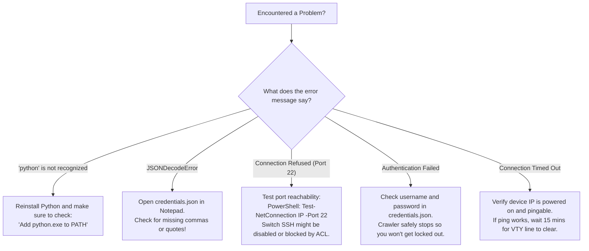

<!--
Copyright (C) 2026 Leif Davisson <leifdavisson@gmail.com>

This program is free software: you can redistribute it and/or modify
it under the terms of the GNU Affero General Public License as published by
the Free Software Foundation, either version 3 of the License, or
(at your option) any later version.

This program is distributed in the hope that it will be useful,
but WITHOUT ANY WARRANTY; without even the implied warranty of
MERCHANTABILITY or FITNESS FOR A PARTICULAR PURPOSE.  See the
GNU Affero General Public License for more details.

You should have received a copy of the GNU Affero General Public License
along with this program.  If not, see <https://www.gnu.org/licenses/>.
-->

# Net-Docu-Crawler: Junior Operator Day-One Field Guide

Welcome to the team! This operational field guide was written specifically for **field technicians, junior network operators, IT helpdesk engineers, and apprentices** on Day One. 

Even if you have **never written a single line of Python**, have never used Git, and only know the absolute basics (like what an IP address looks like), **you can run this tool with 100% confidence**.

---

## The Golden Rule: You Cannot Break Anything

> [!IMPORTANT]
> **Net-Docu-Crawler has a Zero Blast Radius.**
> 
> * **It only reads**: It connects to switches, routers, and firewalls and asks them read-only questions like `"show version"` or `"show lldp info remote-device"`.
> * **It never writes**: It does not change configurations, update routing tables, reboot devices, or save changes to NVRAM.
> * **It protects your access**: It automatically closes connections cleanly so nobody gets locked out of switch consoles.

Think of it like visiting a restaurant: Net-Docu-Crawler **only looks at the menu**; it never changes the recipe or orders anything without your permission.

---

## 1. Quick Day-One Vocabulary (Plain English)

Before typing anything, here is what these common network words mean:

* **IP Address** (e.g., `192.168.1.1`): The unique phone number or street address of a specific device on your network.
* **Subnet / CIDR** (e.g., `192.168.1.0/24`): A whole street or neighborhood block of IP addresses. The `/24` means all 254 addresses from `192.168.1.1` to `192.168.1.254`.
* **Default Gateway**: The "front door" router or firewall that lets devices in your office talk to the rest of the company or the internet. Usually ends in `.1` or `.254`.
* **Switch**: The box with 24 or 48 ports that computers, printers, and WiFi access points plug into.
* **Router / Firewall**: The security appliance that inspects traffic and routes packets between different networks.
* **SSH (Secure Shell)**: An encrypted command-line telephone call your computer makes to a switch to talk to it.
* **Terminal / PowerShell**: The window where you type instructions directly to your computer instead of clicking with a mouse.
* **CSV File (`.csv`)**: A spreadsheet file you can double-click to open directly in **Microsoft Excel**.

---

## 2. Phase 1: Getting Your Laptop Ready

Net-Docu-Crawler runs on Python (version 3.10 or newer). Follow the instructions for your operating system:

### Option A: You Are on Windows (Most Common)

1. **Open PowerShell**:
   - Press the `Windows Key + R` on your keyboard.
   - In the "Run" box, type `powershell` and press **Enter**.
2. **Check if Python is installed**:
   - In the blue PowerShell window, type:
     ```powershell
     python --version
     ```
   - If it prints `Python 3.10.x` (or 3.11, 3.12, 3.13, 3.14), you are ready for Step 3!
3. **If Python is NOT installed or opens the Windows Store**:
   - Go to [https://www.python.org/downloads/](https://www.python.org/downloads/) in your web browser.
   - Click the big yellow **Download Python** button.
   - Run the downloaded installer file.
   - ⚠️ **VERY CRUCIAL**: On the very first installer screen, look at the bottom and **check the box** that says:
     `☑ Add python.exe to PATH`
   - Then click **Install Now**.
   - When finished, close and reopen PowerShell, and re-run `python --version` to verify.

### Option B: You Are on macOS or Linux

1. Open your **Terminal** application.
2. Check your Python version:
   ```bash
   python3 --version
   ```
3. If not installed:
   - **Ubuntu/Debian Linux**: `sudo apt update && sudo apt install -y python3 python3-pip git`
   - **macOS**: Open Terminal and run `xcode-select --install`, or install Homebrew ([brew.sh](https://brew.sh)) and run `brew install python`.

---

## 3. Phase 2: Download the Project and Install Helpers

In your PowerShell or Terminal window, run these commands one at a time:

```bash
# 1. Download the crawler code to your laptop
git clone https://github.com/leifdavisson/net-docu-crawler.git

# 2. Enter the crawler directory
cd net-docu-crawler

# 3. Install the required helper libraries (Netmiko, Paramiko, netaddr)
pip install -r requirements.txt
```

*(Note for Linux/Mac users: If `pip` says command not found, use `pip3 install -r requirements.txt`).*

---

## 4. Phase 3: Setting Up Your Passwords (`credentials.json`)

To log into switches and read their port statuses, the crawler needs your management username and password.

### Step-by-Step Instructions:
1. Make a copy of the template credentials file:
   * **Windows (PowerShell)**:
     ```powershell
     Copy-Item credentials.example.json credentials.json
     notepad credentials.json
     ```
   * **macOS / Linux**:
     ```bash
     cp credentials.example.json credentials.json
     nano credentials.json
     ```
2. You will see a file that looks like this:
   ```json
   [
     {
       "username": "admin",
       "password": "YourSwitchPasswordHere",
       "enable_secret": ""
     }
   ]
   ```
3. Replace `"admin"` with your actual switch admin username.
4. Replace `"YourSwitchPasswordHere"` with your switch password.
5. If your network uses Cisco devices with an "enable" password, put that in `"enable_secret"`. Otherwise, leave it as `""`.
6. Press `Ctrl + S` to save the file, then close Notepad.

> [!NOTE]
> **Password Privacy Guarantee**:
> `credentials.json` is permanently listed in the project's `.gitignore` file. Even if you run Git commands, your personal passwords can **never** be committed or uploaded to GitHub.

---

## 5. Phase 4: Your First 5-Minute Run ("Hello World")

Let's test the crawler on just **one device** first (usually your office core switch or default gateway).

### 1. How to Find Your Gateway IP:
* **Windows**: In PowerShell, type `ipconfig`. Look for the line that says `Default Gateway . . . . . : 192.168.1.1`.
* **macOS / Linux**: In Terminal, type `ip route` or `netstat -rn`. Look for `default via 192.168.1.1`.

### 2. Run the Crawl Command:
Run the following command (substituting your actual device IP):

```bash
python net_crawler.py --targets 192.168.1.1 --organize
```

*(On macOS/Linux, run `python3 net_crawler.py --targets 192.168.1.1 --organize`).*

### 3. What You Will See on Your Screen:
The crawler will print real-time status messages showing its 4-tier discovery cascade:

```text
[*] Starting Net-Docu-Crawler discovery...
[*] Target list: 1 target(s) specified
[*] [Tier 1] Checking local ARP cache for 192.168.1.1... MAC found (00:08:e3:...)
[*] [Tier 2] Inspecting SSH banner on 192.168.1.1:22... Cisco IOS detected!
[*] Authenticating using credentials from credentials.json... Success!
[*] Running read-only operational collection:
    -> show version (Chassis: CISCO891-K9, Serial: FCZ1234567)
    -> show ip interface brief (9 interfaces discovered)
    -> show cdp neighbors detail / show lldp info (2 neighbor switches connected)
    -> show ip route (Default gateway: 0.0.0.0/0 via 100.64.224.1)
[*] Disconnecting SSH session cleanly... Done (0 orphaned VTY sessions).
[+] Resolving network topology and building deliverables...
[+] Deliverables organized in: docs/reports/192.168.1.1_20261108_143000_lan/
```

Congratulations! You just completed your first automated enterprise network crawl! 🎉

---

## 6. Phase 5: Crawling Multiple Switches or Whole Subnets

Once you know the crawler works on one device, you can crawl an entire building, floor, or rack.

### Crawl a List of Specific Switches:
```bash
python net_crawler.py --targets 192.168.1.1 192.168.1.2 192.168.1.3 --organize
```

### Crawl an Entire Subnet:
To discover every active switch across an entire `/24` subnet:
```bash
python net_crawler.py --targets 192.168.1.0/24 --organize
```
*(The crawler checks port 22 first, so it only attempts SSH logins on devices that actually listen on SSH, ignoring standard computers and printers).*

### What if a Switch Has a Custom or Non-Standard Banner?
If the crawler says `Unknown Vendor` because a switch has a custom login message, tell it the brand using `--vendor-hint`:
```bash
python net_crawler.py --targets 192.168.1.1 --vendor-hint cisco --organize
```
*(Supported hints: `cisco`, `juniper`, `arista`, `aruba`, `mikrotik`, `fortinet`, `paloalto`, `opnsense`, `openwrt`, `frr`)*.

---

## 7. Phase 6: Delivering the Results to Your Team or Boss

When you pass the `--organize` flag, the crawler creates a neat, timestamped folder inside `docs/reports/`:

```text
docs/reports/192.168.1.0-24_20261108_143000_lan/
├── Network_Analysis.md
├── asset_inventory.csv
├── migration_cabling_matrix.csv
├── L2_network_diagrams.md
├── L3_network_diagrams.md
├── net_docu_crawler_live_report.md
├── cisco_to_target_translation.md
└── logs/
```

Here is a guide on which file to use for different tasks:

| Deliverable File | What Is Inside | How to Open & Present It |
| :--- | :--- | :--- |
| **`asset_inventory.csv`** | Clean hardware inventory: Switch name, Management IP, MAC address, Hardware Model, Serial Number, and Firmware version. | **Double-click to open in Microsoft Excel**. Send this to your boss or IT asset manager for budgeting and lifecycle reviews. |
| **`migration_cabling_matrix.csv`** | Physical cabling schedule: Port-by-port mapping showing exactly what switch port connects to which remote switch or AP, link speeds (1G/10G), and duplex. | **Double-click to open in Microsoft Excel**. Print this out and take it into the server room when tracing or moving patch cables. |
| **`Network_Analysis.md`** | **The Migration Blueprint**: Executive summary, chassis replacement table, VLAN map, cabling schedules, and migration risk checklist. | Open in **Typora**, **VS Code** (press `Ctrl + Shift + V` to preview), or view on GitHub. Hand this directly to your Senior Network Engineer. |
| **`L2_network_diagrams.md`** | Interactive physical switching topology flowchart and Wireless Access Point overlay table. | Open in **Typora** or preview in VS Code / GitHub to view the interactive diagram. |
| **`L3_network_diagrams.md`** | Authoritative routing topology: VLAN subnets, CIDR blocks, and gateway IP assignments. | Open in **Typora** or VS Code. |
| **`net_docu_crawler_live_report.md`** | Health audit: Port utilization percentages, Spanning Tree root bridge audit, and DNS/NTP/AAA status. | Open in **Typora** or any markdown viewer. |
| **`logs/`** | Complete audit trail recording every command issued and every response received. | Open in **Notepad** if a senior engineer asks to see the raw session logs. |

---

## 8. Phase 7: Plain-English Troubleshooting ("When Things Don't Work")

Don't panic! Here are the 5 most common hiccups and how to solve them in under 60 seconds:



### 1. `"python is not recognized as an internal or external command"`
* **Why it happens**: Python was installed, but the installer didn't add Python to your Windows system PATH.
* **The 10-second fix**: Type `py net_crawler.py ...` instead of `python net_crawler.py ...`.
* **Permanent fix**: Re-run the Python installer from [python.org](https://www.python.org/downloads/), click **Modify**, and check **Add Python to environment variables**.

### 2. `"JSONDecodeError: Expecting ',' delimiter"`
* **Why it happens**: When editing `credentials.json` in Notepad, an extra quote `"` or missing comma `,` was saved by accident.
* **The fix**: Open `credentials.json` in Notepad and compare it with `credentials.example.json`. Every string must have opening and closing quotes (`"username"`).

### 3. `"Connection Refused"` on Port 22
* **Why it happens**: The switch IP address exists, but it is not listening for SSH connections.
* **What to check**:
  - Test the port from PowerShell:
    ```powershell
    Test-NetConnection -ComputerName 192.168.1.1 -Port 22
    ```
  - If `TcpTestSucceeded : False`, SSH might be disabled in the switch configuration, or a management ACL is restricting SSH to specific admin workstations.

### 4. `"Authentication Failed"`
* **Why it happens**: The switch rejected your username or password.
* **What to check**:
  - Verify your password by logging into the switch manually with standard SSH:
    ```bash
    ssh admin@192.168.1.1
    ```
  - **Account Lockout Safety**: Net-Docu-Crawler will **never try more than one password per username**. It will never lock out your company Active Directory or TACACS+ account.

### 5. `"Connection Timed Out"`
* **Why it happens**: Your computer sent packets to the switch, but received zero replies after 10 seconds.
* **What to check**:
  - Test basic network reachability: `ping 192.168.1.1`.
  - If ping fails, you might be on the wrong WiFi network or VLAN.
  - If ping succeeds but SSH times out, all switch terminal sessions (VTY lines) may be temporarily occupied by other administrators. Wait 10 to 15 minutes and try again.

---

## 9. Phase 8: Advanced Concepts for Career Growth

As you grow in your network engineering career, understanding **why** production networks require gentle handling will make you a trusted engineer on your team.

### What is a VTY Line?
* **Definition**: A **Virtual Teletype (VTY)** line is a virtual terminal session allocated by network operating systems (Cisco IOS, Junos, AOS-CX, FortiOS, PAN-OS) whenever an administrator or script connects over SSH.
* **Line Limits**: Most enterprise access switches have a strict limit of **5 to 16 concurrent VTY lines** (e.g., `line vty 0 4` = 5 lines, or `line vty 0 15` = 16 lines).
* **The VTY Exhaustion Hazard**:
  When a naive script issues a long command (like `show running-config`) without disabling pagination (`terminal length 0`), the switch pauses output with a `--More--` prompt and waits indefinitely for user keyboard input.
  If the script times out and abruptly closes the TCP socket without sending `exit` or `quit`, the switch operating system often keeps that VTY session alive in an orphaned state until its idle timer (typically 10 to 30 minutes) expires.
  If this happens across multiple crawl attempts, all 5 or 16 VTY lines become exhausted. **Result**: Human engineers are completely locked out of the switch CLI until the sessions time out or the switch is power-cycled.
* **How Net-Docu-Crawler Protects VTY Lines**:
  1. Sets vendor-correct pagination suppression **before** executing data collection commands.
  2. Wraps all SSH sessions in strict `try ... finally: conn.disconnect()` blocks to ensure VTY sessions are cleanly closed even if an unhandled error occurs.
  3. Limits concurrency and enforces per-IP crawl locks in [`DeviceRegistry`](../net_docu_crawler/topology_resolver.py).

### What is an AAA Anti-Lockout Threshold?
* **Enterprise Authentication**: In production networks, switches authenticate logins through centralized AAA servers: **TACACS+** (Cisco ISE, Aruba ClearPass) or **RADIUS** (Microsoft NPS, FreeRADIUS) backed by Active Directory.
* **Lockout Policy**: Security policies routinely lock out an Active Directory account if it fails 3 to 5 consecutive login attempts.
* **The Scripting Trap**: A naive crawler iterating through 10 passwords against 50 switches could attempt 500 bad logins, locking out the enterprise network engineering service account across the entire company within seconds.
* **How Net-Docu-Crawler Protects AAA Accounts**:
  The crawler maintains a strict attempt ledger: **no username is ever tried more than once against a given target IP**. If `admin` fails with Password A, the crawler will never retry `admin` on that device during the session.

---

## 10. Emergency Switch Console Commands (For Field Techs)

If you have physical console cable access or an active administrative session and need to inspect or clear stuck sessions on a switch:

### Cisco IOS / IOS-XE / NX-OS:
```cisco
show users                ! Lists active VTY lines and idle times
clear line vty <number>   ! Terminate an orphaned VTY session
show ip ssh               ! Verify SSH version and key status
```

### Juniper Junos OS:
```junos
show system users         ! Lists active CLI sessions
request system logout pid <PID>  ! Terminate an orphaned session
```

### Fortinet FortiOS:
```text
diagnose sys session list
execute disconnect-admin <ID>
```

### Palo Alto PAN-OS:
```panos
show admins
show system logins
```
