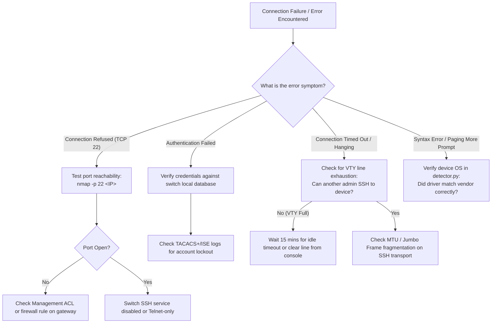

<!--
Copyright (C) 2026 Leif Davisson <leifdavisson@gmail.com>

This program is free software: you can redistribute it and/or modify
it under the terms of the GNU Affero General Public License as published by
the Free Software Foundation, either version 3 of the License, or
(at your option) any later version.

This program is distributed in the hope that it will be useful,
but WITHOUT ANY WARRANTY; without even the implied warranty of
MERCHANTABILITY or FITNESS FOR A PARTICULAR PURPOSE.  See the
GNU Affero General Public License for more details.

You should have received a copy of the GNU Affero General Public License
along with this program.  If not, see <https://www.gnu.org/licenses/>.
-->

# Net-Docu-Crawler: Junior Operator Troubleshooting Playbook

[Open junior_operator_playbook.md](junior_operator_playbook.md)

This operational guide is written specifically for junior network operators, site reliability engineers, and field technicians running **Net-Docu-Crawler** in production enterprise environments.

---

## 1. Core Networking Concepts: VTY Lines, AAA, and Banners

### What is a VTY Line?
* **Definition**: A **Virtual Teletype (VTY)** line is a virtual terminal session that network operating systems (Cisco IOS, JunOS, AOS-CX, FortiOS, PAN-OS) allocate whenever an operator or script connects over SSH or Telnet.
* **Line Limits**: Most enterprise access switches have a strict limit of **5 to 16 concurrent VTY lines** (e.g., `line vty 0 4` = 5 lines, or `line vty 0 15` = 16 lines).
* **The VTY Exhaustion Hazard**:
  When an automated script issues a long command (like `show running-config`) without disabling pagination (`terminal length 0`), the switch pauses output with a `--More--` prompt and waits indefinitely for user keyboard input.
  If the script times out and abruptly closes the TCP socket without sending `exit` or `quit`, the switch operating system often keeps that VTY session alive in an orphaned state until its idle timer (typically 10 to 30 minutes) expires.
  If this happens repeatedly across multiple crawl threads, all 5 or 16 VTY lines become exhausted. **Result**: Human engineers are completely locked out of the switch CLI until the sessions time out or the switch is power-cycled.
* **How Net-Docu-Crawler Protects VTY Lines**:
  1. Sets vendor-correct pagination suppression **before** executing data collection commands.
  2. Wraps all SSH sessions in strict `try ... finally: conn.disconnect()` blocks to ensure VTY sessions are cleanly closed even if an unhandled error occurs.
  3. Limits concurrency and enforces per-IP crawl mutexes in [`DeviceRegistry`](../net_docu_crawler/topology_resolver.py).

### What is an AAA Anti-Lockout Threshold?
* **Enterprise Authentication**: In production networks, switches authenticate logins through centralized AAA servers: **TACACS+** (Cisco ISE, Aruba ClearPass) or **RADIUS** (Microsoft NPS, FreeRADIUS) backed by Active Directory.
* **Lockout Policy**: Security policies routinely lock out an Active Directory account if it fails 3 to 5 consecutive login attempts.
* **The Scripting Trap**: A naive crawler iterating through 10 passwords against 50 switches could attempt 500 bad logins, locking out the enterprise network engineering service account across the entire company within seconds.
* **How Net-Docu-Crawler Protects AAA Accounts**:
  The crawler maintains a strict attempt ledger: **no username is ever tried more than once against a given target IP**. If `admin` fails with Password A, the crawler will never retry `admin` on that device during the session.

---

## 2. Viewing Reports and Mermaid Topologies in Typora

Net-Docu-Crawler generates rich Markdown reports accompanied by live Mermaid topology diagrams.

### Why Typora?
[Typora](https://typora.io/) provides seamless, real-time rendering of GitHub Flavored Markdown (GFM) and complex Mermaid flowcharts (`flowchart TD`, `graph LR`, `sequenceDiagram`) directly on screen without needing external browser plugins.

### Opening Artifacts in Typora:
* **Linux**:
  ```bash
  typora docs/architecture.md &
  ```
* **Windows**:
  Right-click any generated `.md` file in File Explorer and select **Open with Typora**, or execute from PowerShell:
  ```powershell
  Start-Process typora.exe "docs\architecture.md"
  ```

---

## 3. Step-by-Step Operator Troubleshooting Workflow



---

## 4. Emergency Commands for Field Operators

If you have console access or an active VTY session on a switch and need to inspect or clear stuck sessions:

### Cisco IOS / NX-OS:
```cisco
show users                ! Lists active VTY lines and idle times
clear line vty <number>   ! Terminate an orphaned VTY session
show ip ssh               ! Verify SSH version and key status
```

### Juniper JunOS:
```junos
show system users         ! Lists active CLI sessions
request system logout pid <PID>  ! Terminate an orphaned JunOS session
```

### Fortinet FortiOS:
```text
diagnose sys session list
execute disconnect-admin <ID>
```

### Palo Alto PAN-OS:
```panos
show admins
show system logins
```
