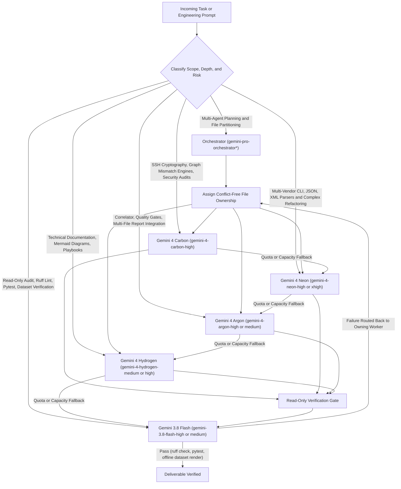

<!--
Copyright (C) 2026 Leif Davisson <leifdavisson@gmail.com>
SPDX-License-Identifier: AGPL-3.0-or-later
-->

# Model & Prompt Routing Strategy

This document defines the multi-model prompt classification, thinking-level policy, quota fallback chains, and parallel swarm work-assignment strategy for **Net-Docu-Crawler**, built around the [Google Gemini API Models](https://ai.google.dev/gemini-api/docs/models) and [Google DeepMind Gemini](https://deepmind.google/technologies/gemini/) model family.

---

## 1. Prompt-Routing Architecture

Incoming engineering tasks are classified by blast radius, algorithmic depth, protocol complexity, and read/write scope before dispatching to the appropriate model tier and thinking budget.

---

## 2. Google Gemini Model Capability & Cost/Latency Routing Matrix

| Model Family | Exact Model IDs | Primary Role in `net-docu-crawler` | Relative Cost | Relative Latency | Optimal Workloads |
| :--- | :--- | :--- | :--- | :--- | :--- |
| **Orchestrator (Carbon / Argon / Neon)** | `gemini-pro-orchestrator`, `gemini-pro-orchestrator-argon`, `gemini-pro-orchestrator-neon` | Strategic planning, mission decomposition, conflict-free file partitioning | High (Planning) | Medium-High | Decomposing GitHub issues into disjoint worker ownership boundaries, defining cross-module contracts, and coordinating swarm handoffs. |
| **Gemini 4 Carbon** | `gemini-4-carbon-high`, `gemini-4-carbon-medium`, `gemini-4-carbon-low` | Deep-reasoning heavyweight | High | High | Cryptographic & SSH wire-protocol engineering ([Paramiko](https://www.paramiko.org/), [pyca/cryptography](https://cryptography.io/)), bidirectional graph mismatch engines ([netaddr](https://netaddr.readthedocs.io/)), and zero-blast-radius security audits. |
| **Gemini 4 Neon** | `gemini-4-neon-xhigh`, `gemini-4-neon-high`, `gemini-4-neon-medium`, `gemini-4-neon-low` | Nov 2026 frontier high-efficiency coder | Medium-High | Medium | Multi-vendor CLI/JSON/XML/UCI grammar parsing ([Cisco IOS & NX-OS](https://www.cisco.com/c/en/us/support/ios-nx-os-software/index.html), [Juniper Junos](https://www.juniper.net/documentation/product/us/en/junos-os/), [HPE Aruba AOS-CX](https://www.arubanetworks.com/techdocs/AOS-CX/help_portal/Content/home.htm), [ArubaOS-S](https://www.arubanetworks.com/techdocs/AOS-S/16.10/MWG/content/home.htm), [Arista EOS](https://www.arista.com/en/um-eos)), token-efficient complex refactoring across multiple [Netmiko](https://github.com/ktbyers/netmiko) drivers. |
| **Gemini 4 Argon** | `gemini-4-argon-high`, `gemini-4-argon-medium`, `gemini-4-argon-low` | General end-to-end pipeline integrator | Medium | Medium | Wiring `correlator.py`, `quality_gates.py`, `crawler.py`, and `report_generator.py`; maintaining backward compatibility across existing CSV/JSON/Markdown contracts. |
| **Gemini 4 Hydrogen** | `gemini-4-hydrogen-xhigh`, `gemini-4-hydrogen-high`, `gemini-4-hydrogen-medium`, `gemini-4-hydrogen-low` | High-speed execution & technical documentation | Low-Medium | Low | Authoring driver specifications, `README.md` updates, Mermaid topology/architecture guides, and structured markdown playbooks without sacrificing accuracy. |
| **Gemini 3.8 Flash** | `gemini-3.8-flash-high`, `gemini-3.8-flash-medium`, `gemini-3.8-flash-low` | High-throughput read-only verification | Lowest | Lowest | Diff auditing, AGPLv3/backlink compliance scans, `ruff check .` linting, `pytest -v` regression execution, and offline `--from-dataset` render smoke tests. |

Refer to the [Google Gemini API Models](https://ai.google.dev/gemini-api/docs/models) documentation and [Google DeepMind Gemini](https://deepmind.google/technologies/gemini/) overview for upstream API capabilities and parameter specifications.

---

## 3. Thinking-Level Policy (`low`, `medium`, `high`, `xhigh`)

Thinking budgets govern how many internal reasoning tokens a model allocates before emitting code, tool calls, or documentation. Choosing the lowest sufficient level preserves quota and turnaround speed while reserving deep reasoning for failure-prone logic.

| Thinking Level | Target Models | When to Use | `net-docu-crawler` Examples |
| :--- | :--- | :--- | :--- |
| **`low`** | `*-low` (`flash`, `hydrogen`, `argon`, `neon`, `carbon`) | Deterministic checks, boilerplate generation, single-file formatting, simple lookup queries | Checking `git status -sb`, running `ruff check .`, verifying AGPLv3 header presence, updating static table rows. |
| **`medium`** | `*-medium` (`flash`, `hydrogen`, `argon`, `neon`, `carbon`) | Well-specified multi-file integration, documentation authoring from known specs, standard unit tests | Updating `README.md` deliverables, writing `docs/drivers/*.md` command matrices, wiring `correlator.py` and `quality_gates.py` against a frozen contract. |
| **`high`** | `*-high` (`flash`, `hydrogen`, `argon`, `neon`, `carbon`) | Multi-step protocol state machines, graph invariants, cross-vendor edge cases, full-repo audit verification | Implementing 3-stage SSH KEX/host-key fallback in `net_docu_crawler/ssh_compat.py`, building `net_docu_crawler/trunk_audit.py` rules `TRK-001`..`TRK-007`, auditing full swarm diffs in `verifier`. |
| **`xhigh`** | `gemini-4-neon-xhigh`, `gemini-4-hydrogen-xhigh` | Extreme-density parsing or refactoring across many heterogeneous vendor syntaxes in one pass | Normalizing Cisco IOS/NX-OS multi-line `switchport trunk allowed vlan add`, `dot1q-tunnel`, Junos `native-vlan-id` vs tagged native, Aruba AOS-CX stanzas, and L3 dot1Q subinterfaces simultaneously without breaking existing driver mocks. |

---

## 4. Prompt-Classification Rules for `net-docu-crawler`

Route every task using the following deterministic rule order:

1. **Rule 1 — Swarm Decomposition & Contract Design**:
   - *Signals*: Multiple unrelated modules, parallelizable workstreams, shared data contracts (`device_data`, `port_profiles`, `trunk_audit`).
   - *Route*: `Orchestrator (Carbon / Argon / Neon)` (`gemini-pro-orchestrator*`).
2. **Rule 2 — Transport Security, Cryptography & Graph Algorithms**:
   - *Signals*: [Paramiko](https://www.paramiko.org/) `Transport._kex_info` / `_key_info`, [pyca/cryptography](https://cryptography.io/) DSA/RSA signatures, [OPNsense](https://docs.opnsense.org/) non-interactive SSH exec fallback, bidirectional graph edge canonicalization, LAG parent collapsing, CIDR overlap math via [netaddr](https://netaddr.readthedocs.io/).
   - *Route*: `Gemini 4 Carbon` (`gemini-4-carbon-high`, fallback `medium`).
3. **Rule 3 — Multi-Vendor CLI/JSON/XML Parser Engineering**:
   - *Signals*: Regular expressions, Netmiko `send_command` hooks, `| display json` / `| json` / CLI fallback parsing across [Cisco IOS & NX-OS](https://www.cisco.com/c/en/us/support/ios-nx-os-software/index.html), [Juniper Junos](https://www.juniper.net/documentation/product/us/en/junos-os/), [HPE Aruba AOS-CX](https://www.arubanetworks.com/techdocs/AOS-CX/help_portal/Content/home.htm), [ArubaOS-S](https://www.arubanetworks.com/techdocs/AOS-S/16.10/MWG/content/home.htm), and [Arista EOS](https://www.arista.com/en/um-eos).
   - *Route*: `Gemini 4 Neon` (`gemini-4-neon-high` or `gemini-4-neon-xhigh`).
4. **Rule 4 — End-to-End Pipeline & Deliverable Wiring**:
   - *Signals*: `correlator.py`, `quality_gates.py`, `crawler.py`, `report_generator.py`, CSV/JSON/Markdown deliverable schemas, backward-compatibility test suites.
   - *Route*: `Gemini 4 Argon` (`gemini-4-argon-high` or `gemini-4-argon-medium`).
5. **Rule 5 — Documentation, Architecture Diagrams & Operator Guides**:
   - *Signals*: `README.md`, `docs/*.md`, `docs/drivers/*.md`, Mermaid diagrams, AGPLv3 attribution & official vendor backlinks.
   - *Route*: `Gemini 4 Hydrogen` (`gemini-4-hydrogen-medium` or `gemini-4-hydrogen-high`).
6. **Rule 6 — Read-Only Verification, Linting & Smoke Tests**:
   - *Signals*: No file edits permitted; `ruff check .`, `pytest -v`, `net_crawler.py --from-dataset`, diff compliance checks, stall monitoring.
   - *Route*: `Gemini 3.8 Flash` (`gemini-3.8-flash-high` for final full-suite gate; `gemini-3.8-flash-medium` or `low` for continuous stall monitoring).

---

## 5. Quota & Capacity Fallback Chains

When a worker receives a `[quota]` low-quota warning or hits capacity limits on its pinned model, switch the **waiting** worker in-place via `swarm{action:"model", name, model}` to preserve its conversation history (never `kill` and `add` a fresh worker for quota reasons):

| Primary Model | Fallback 1 | Fallback 2 | Emergency Fallback |
| :--- | :--- | :--- | :--- |
| `gemini-pro-orchestrator` | `gemini-pro-orchestrator-neon` | `gemini-pro-orchestrator-argon` | `gemini-4-carbon-high` |
| `gemini-4-carbon-high` | `gemini-4-neon-xhigh` | `gemini-4-argon-high` | `gemini-4-carbon-medium` |
| `gemini-4-neon-xhigh` / `high` | `gemini-4-neon-medium` | `gemini-4-argon-high` | `gemini-4-hydrogen-xhigh` |
| `gemini-4-argon-high` / `medium` | `gemini-4-hydrogen-high` | `gemini-4-neon-medium` | `gemini-3.8-flash-high` |
| `gemini-4-hydrogen-high` / `medium` | `gemini-4-hydrogen-low` | `gemini-3.8-flash-high` | `gemini-3.8-flash-medium` |
| `gemini-3.8-flash-high` | `gemini-3.8-flash-medium` | `gemini-3.8-flash-low` | `gemini-4-hydrogen-low` |

---

## 6. Concrete Work-Assignment Table: GitHub Issues #1 & #2

The following assignment matrix reflects the live conflict-free swarm partitioning used to deliver **Issue #1 (3-Stage SSH Fallback)** and **Issue #2 (Trunk VLAN Mismatch Detection)**:

| Swarm Member | Issue Scope | Recommended Model & Thinking Level | Exclusive File Ownership | Key Deliverables |
| :--- | :--- | :--- | :--- | :--- |
| **`coordinator`** | Issues #1 & #2 | `gemini-pro-orchestrator` | Planning & board coordination only | Contracts A, B, C; conflict-free file partitioning; final user report |
| **`ssh-compat`** | Issue #1 | `gemini-4-carbon-high` | `net_docu_crawler/ssh_compat.py`, `net_docu_crawler/drivers/base.py`, `net_docu_crawler/drivers/opnsense.py`, `tests/test_ssh_compat.py` | RFC 8731 `curve25519-sha256`, RFC 3526 `diffie-hellman-group18-sha512`, `LegacyDSSKey` (`ssh-dss`), 3-stage Netmiko & [Paramiko](https://www.paramiko.org/) fallback |
| **`trunk-engine`** | Issue #2 | `gemini-4-carbon-high` | `net_docu_crawler/trunk_audit.py`, `tests/test_trunk_audit.py` | `TrunkPortState`, `canonicalize_interface_full`, `expand_vlan_spec`, LAG collapsing, `TRK-001`..`TRK-007`, `ERR_UNCRAWLED_NEIGHBOR`, `WARN_ASYMMETRIC_DISCOVERY`, `INFO_QINQ_BOUNDARY` |
| **`vendor-parsers`** | Issue #2 | `gemini-4-neon-xhigh` | `net_docu_crawler/migration_parsers.py`, `net_docu_crawler/drivers/{cisco,juniper,aruba,hpprocurve,arista,ciscosmb}.py`, `tests/test_trunk_vendor_parsers.py` | Contract B `port_profiles` fields (`admin_mode`, `oper_mode`, `native_vlan_tagged`, `trunk_active_vlans`, `encapsulation`, `qinq_tunnel`, `is_subinterface_bundle`) & `get_l2_operational()` extensions |
| **`pipeline-reports`** | Issue #2 | `gemini-4-argon-high` | `net_docu_crawler/correlator.py`, `net_docu_crawler/quality_gates.py`, `net_docu_crawler/crawler.py`, `report_generator.py`, `tests/test_trunk_reporting.py` | `GATE_TRUNK_VLAN_MISMATCH`, `03_correlated/trunk_audit.json`, `03_correlated/trunk_mismatches.csv`, `05_reports/trunk_vlan_audit.md`, live report & blueprint audit tables |
| **`docs-routing`** | Issues #1 & #2 | `gemini-4-hydrogen-medium` | `docs/model_prompt_routing_strategy.md`, `README.md`, `docs/drivers/{overview,cisco,juniper,aruba,hpprocurve}.md` | Prompt-routing strategy & diagram, updated deliverables in `README.md`, 3-stage SSH & read-only trunk command docs |
| **`verifier`** | Issues #1 & #2 | `gemini-3.8-flash-high` | Read-only (no edits) | AGPLv3/backlink audit, `ruff check .`, `pytest -v`, offline `--from-dataset` render verification |
| **`monitor`** | Swarm Health | `gemini-3.8-flash-low` | Read-only (no edits) | Stall detection and prompt unblock notifications |
