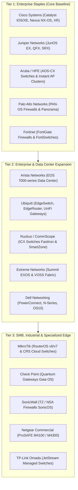
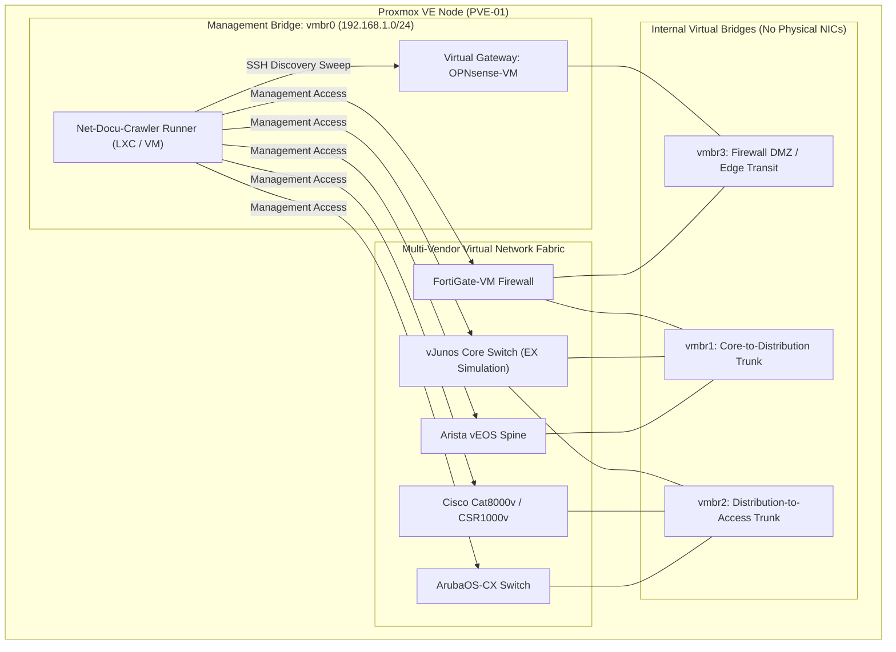

<!--
Copyright (C) 2026 Leif Davisson <leifdavisson@gmail.com>

This program is free software: you can redistribute it and/or modify
it under the terms of the GNU Affero General Public License as published by
the Free Software Foundation, either version 3 of the License, or
(at your option) any later version.

This program is distributed in the hope that it will be useful,
but WITHOUT ANY WARRANTY; without even the implied warranty of
MERCHANTABILITY or FITNESS FOR A PARTICULAR PURPOSE.  See the
GNU Affero General Public License for more details.

You should have received a copy of the GNU Affero General Public License
along with this program.  If not, see <https://www.gnu.org/licenses/>.
-->

# Net-Docu-Crawler: Hardware Coverage Roadmap, Driver Specification & Proxmox Test Lab

[Open proxmox_lab_and_driver_roadmap.md](proxmox_lab_and_driver_roadmap.md)

This specification defines the multi-vendor hardware coverage strategy, the engineering checklist for authoring new vendor drivers, and a blueprint for building an automated Proxmox VE network testing laboratory.

---

## 1. Network Hardware Coverage Roadmap

To provide comprehensive enterprise and branch discovery without bloat, platforms are grouped into three priority tiers based on market prevalence and deployment frequency:



### Coverage Master Table

| Priority Tier | Vendor | Operating System | Primary Target Hardware | Device Personas | Driver Status |
| :--- | :--- | :--- | :--- | :--- | :--- |
| **Tier 1** | **Cisco Systems** | IOS, IOS-XE, NX-OS, XR | Catalyst 2960/3850/9300, Nexus 9K, ISR/ASR | `switch`, `router` | **Implemented** ([`CiscoDriver`](../net_docu_crawler/drivers/cisco.py)) |
| **Tier 1** | **Juniper Networks** | JunOS | EX2200/EX2300/EX3400/EX4300, QFX, SRX | `switch`, `firewall`, `router` | **Implemented** ([`JuniperDriver`](../net_docu_crawler/drivers/juniper.py)) |
| **Tier 1** | **Aruba / HPE** | AOS-CX, ArubaOS | Aruba 6100/6200/6300 CX, Instant APs (IAP-215/315/515) | `switch`, `ap` | **Implemented** ([`ArubaDriver`](../net_docu_crawler/drivers/aruba.py)) |
| **Tier 1** | **Palo Alto Networks** | PAN-OS | PA-220, PA-440, PA-3200, PA-VM | `firewall` | **Implemented** ([`PaloAltoDriver`](../net_docu_crawler/drivers/paloalto.py)) |
| **Tier 1** | **Fortinet** | FortiOS | FortiGate 40F, 60E/60F, 80F, 100F, VM | `firewall` | **Implemented** ([`FortinetDriver`](../net_docu_crawler/drivers/fortinet.py)) |
| **Tier 2** | **Arista Networks** | EOS | 7050, 7280, 7020 Cloud & Spine Switches | `switch`, `router` | Next Candidate |
| **Tier 2** | **Ubiquiti** | EdgeOS / UniFi | EdgeSwitch 24/48, EdgeRouter ER-X / ER-4 | `switch`, `router` | Next Candidate |
| **Tier 2** | **Ruckus / CommScope**| FastIron | ICX 7150, 7250, 7450 Campus Switches | `switch` | Planned |
| **Tier 2** | **Extreme Networks** | EXOS, VOSS | Summit X440, X460-G2, VSP 7400 | `switch`, `router` | Planned |
| **Tier 2** | **Dell Networking** | DNOS 6 / OS10 | N1500, N2000, N3000, S-Series | `switch` | Planned |
| **Tier 3** | **MikroTik** | RouterOS | Cloud Router Switches (CRS326, CRS328), CCR | `switch`, `router` | Planned |
| **Tier 3** | **Check Point** | Gaia OS | Quantum Security Gateway 3600 / 6200 | `firewall` | Planned |
| **Tier 3** | **SonicWall** | SonicOS | TZ370, TZ470, NSA 2700 | `firewall` | Planned |

---

## 2. Driver Authoring Blueprint: The 7-Point Specification

When adding a new hardware driver to `drivers/`, every driver class must implement [`BaseDriver`](../net_docu_crawler/drivers/base.py) and provide the following 7 parameters:

```
+----------------------------------------------------------------------------------------+
| 1. Netmiko Device Type & Transport Parameters                                         |
|    - Upstream netmiko string (e.g. "arista_eos", "ubiquiti_edgeswitch", "mikrotik_routeros")|
|    - Default TCP port (22), connection delay factors, SSH cipher requirements           |
+----------------------------------------------------------------------------------------+
| 2. Paging Suppression Command                                                          |
|    - Exact command to disable interactive prompts (--More--, Page Down, Screen Breaks)  |
|    - Cisco: terminal length 0      | Juniper: set cli screen-length 0                  |
|    - Aruba: no page               | Palo Alto: set cli pager off                      |
|    - Fortinet: config system console / set output standard / end                       |
+----------------------------------------------------------------------------------------+
| 3. Zero-Blast Prompt Signatures                                                        |
|    - Regular expressions matching unprivileged (`>`) and privileged (`#`) prompts      |
|    - Handling of multi-context/VDOM prompt tags (e.g. `hostname (vdom) #`)              |
+----------------------------------------------------------------------------------------+
| 4. Least-Privilege Read-Only Role                                                      |
|    - Exact configuration snippet defining minimal read-only auditor permissions        |
|    - No write, commit, or reboot capabilities permitted                                |
+----------------------------------------------------------------------------------------+
| 5. Operational Command Mapping (The Core Methods)                                      |
|    - get_version()        -> Hostname, Hardware Model, Chassis Serial, Firmware        |
|    - get_interfaces()     -> Layer 3 IPs & Layer 2 physical interface status           |
|    - get_neighbors()      -> CDP and LLDP neighbor detail parsing                      |
|    - get_routing_table()  -> Routing Information Base (RIB) entries                     |
|    - get_arp_table()      -> Gateway ARP cache (MAC, IP, Interface, Age)              |
|    - get_running_config() -> Declarative text backup of running configuration          |
+----------------------------------------------------------------------------------------+
| 6. Structured Output Strategy                                                          |
|    - Native JSON/XML flags if supported (`| display json`, `| json`, API payload)      |
|    - Fallback regex parsing using TextFSM or robust multi-line splitting                |
+----------------------------------------------------------------------------------------+
| 7. Known Traps & Idiosyncrasies                                                        |
|    - Reverse DNS hangs (e.g., Junos requires `show arp no-resolve`)                    |
|    - Enable secret escalation requirements                                             |
|    - Aggressive SSH idle disconnects                                                   |
+----------------------------------------------------------------------------------------+
```

---

## 3. Proxmox VE Automated Network Lab Blueprint

Building small Proxmox VE nodes (e.g., Intel N100 / AMD Ryzen mini PCs, or a 1U chassis) provides an isolated, repeatable sandbox to test multi-vendor crawls and verify changes before field deployment.

### A. Recommended Virtual Appliance Images for Proxmox (QEMU/KVM)

| Vendor | Virtual Appliance | Format | Min Resources | License / Availability | Notes |
| :--- | :--- | :--- | :--- | :--- | :--- |
| **Juniper** | **vJunos-switch** / **vSRX** | QCOW2 | 2 vCPU, 4GB RAM | Free evaluation from Juniper.net | Full JunOS CLI and native `\| display json`. |
| **Cisco** | **CSR1000v** / **Cat8000v** | QCOW2 / ISO | 1 vCPU, 4GB RAM | Evaluation mode (capped at 100kbps) | Native Cisco IOS-XE CLI and full CDP/LLDP. |
| **Aruba** | **ArubaOS-CX Virtual (OVA)** | QCOW2 | 1 vCPU, 2GB RAM | Free download on Aruba Airheads | Full AOS-CX CLI, REST API, and LLDP. |
| **Fortinet** | **FortiGate-VM** | QCOW2 | 1 vCPU, 1GB RAM | Free perpetual 15-day trial | Full FortiOS CLI, routing, and ARP. |
| **Arista** | **vEOS-lab** | QCOW2 | 1 vCPU, 1.5GB RAM | Free download with Arista account | Fast boot, full EOS CLI and eAPI. |
| **MikroTik** | **Cloud Hosted Router (CHR)** | QCOW2 | 1 vCPU, 256MB RAM | Free perpetual (1Mbps rate limit) | Ultra-lightweight; boots in 3 seconds. |
| **OPNsense** | **OPNsense KVM** | QCOW2 / ISO | 1 vCPU, 1GB RAM | 100% Free Open Source | Serves as the core L3 gateway and DHCP server. |

### B. Proxmox Virtual Bridging Architecture



### C. Automated Regression Testing Workflow

With Proxmox running this virtual fabric, end-to-end regression testing can be automated:
1. **GitHub Actions Self-Hosted Runner**: Run an LXC container on the Proxmox node acting as an automated GitHub Actions runner.
2. **Snapshot Rollback**: Before every test run, a Proxmox API script triggers `qm rollback <vmid> clean-state` on the virtual switches to guarantee consistent state.
3. **Automated Discovery Run**: The runner executes `pytest` and runs `net_crawler.py` against the virtual seed switch.
4. **Topology Verification**: Asserts that all nodes, LLDP links, VLANs, and routing tables match the expected golden schema.

---

## 4. Official Project Attribution & References

- **[Proxmox Virtual Environment (VE)](https://www.proxmox.com/en/proxmox-virtual-environment)**
- **[Netmiko Multi-Vendor Network Automation](https://github.com/ktbyers/netmiko)**
- **[Juniper vJunos-switch Documentation](https://www.juniper.net/documentation/us/en/software/vjunos-switch/)**
- **[Cisco Catalyst 8000v Edge Software](https://www.cisco.com/c/en/us/products/routers/catalyst-8000v-edge-software/index.html)**
- **[ArubaOS-CX Virtual Simulator Documentation](https://www.arubanetworks.com/techdocs/AOS-CX/)**
- **[Fortinet FortiGate-VM Deployment](https://docs.fortinet.com/vm/proxmox/fortigate)**
- **[Arista vEOS-lab Architecture](https://www.arista.com/en/products/eos/veos)**
- **[MikroTik Cloud Hosted Router (CHR)](https://wiki.mikrotik.com/wiki/Manual:CHR)**
