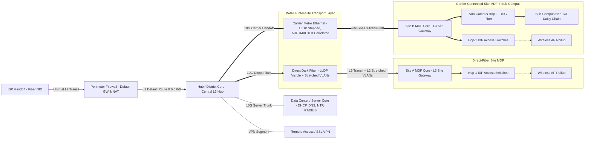
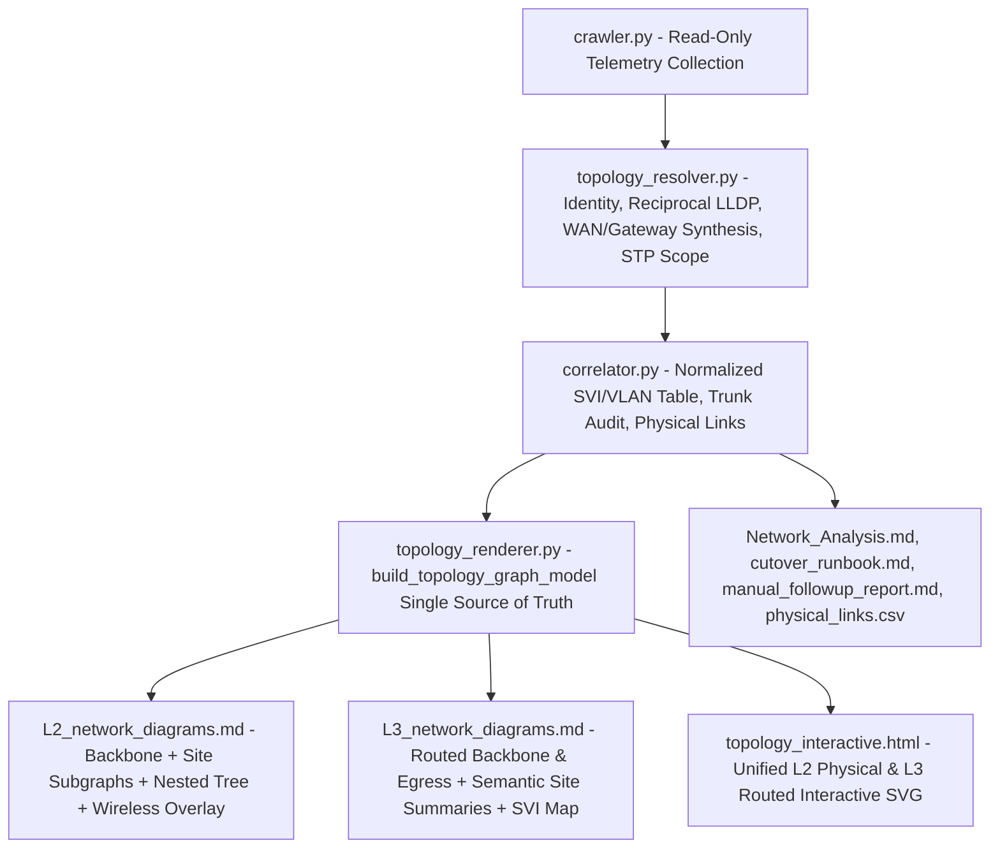

<!--
Copyright (C) 2026 Leif Davisson <leifdavisson@gmail.com>
SPDX-License-Identifier: AGPL-3.0-or-later
-->

# Topology & Diagram Subsystem — Critical Engineering Handoff

> **License**: GNU Affero General Public License v3.0 or later (`AGPL-3.0-or-later`) (<https://www.gnu.org/licenses/agpl-3.0.html>).

This document is the authoritative handoff for `Net-Docu-Crawler`'s topology resolution, diagram generation, and interactive visualization subsystem. It explains **how real multi-site networks actually flow and connect**, **where the current report writer and renderer miss the mark**, and the **target single-source-of-truth contract** that [`report_generator.py`](../report_generator.py), [`net_docu_crawler/topology_renderer.py`](../net_docu_crawler/topology_renderer.py), [`net_docu_crawler/topology_resolver.py`](../net_docu_crawler/topology_resolver.py), and [`net_docu_crawler/correlator.py`](../net_docu_crawler/correlator.py) must satisfy.

---

## 1. How a Campus / Hub-and-Spoke Network Actually Flows (Target Mental Model)

A topology deliverable succeeds only if a reader can answer four operational questions in under 30 seconds:

1. **Where does traffic enter and leave the network?** (ISP handoff -> Perimeter Firewall -> Hub Core default route `0.0.0.0/0` -> central services/servers & VPN).
2. **How do sites connect to the hub and to each other?** (Direct dark fiber vs. carrier Metro Ethernet / MPLS circuits that strip LLDP, plus the exact routed transit subnets and speeds carrying traffic).
3. **Inside each site, what is the real physical hierarchy?** (Site MDF Core -> Hop-1 IDF closets -> Hop-2/Hop-3 daisy-chained sub-campuses or portables -> Wireless APs and end-user edges — along with which switch is actually STP Root and where RSTP is broken).
4. **Where are the logical hazards?** (Mask mismatches on WAN transits, duplicate overlapping subnets across sites, unauthenticated/uncrawled infrastructure switches hiding downstream closets, and centralized DHCP/DNS/RADIUS dependencies).

### 1.1 Canonical Multi-Tier Network Flow Model

Every topology deliverable (L2 Markdown, L3 Markdown, and Interactive HTML) must preserve this vertical/left-to-right flow hierarchy rather than flattening devices into disconnected islands or undirected subnet hairballs:

### 1.2 Why L2 and L3 Must Be Correlated Together

Real production networks frequently break pure LLDP/CDP discovery at exactly the most important boundaries:

- **Carrier Metro Ethernet / WAN handoffs** (e.g., Spectrum Metro-E on an [HPE ArubaOS-Switch / ProCurve](https://www.arubanetworks.com/techdocs/AOS-Switch/) 10G hub port feeding multiple [Juniper Junos OS](https://www.juniper.net/documentation/product/us/en/junos-os/) EX4600 site cores) **strip LLDP frames**. An L2-only graph built strictly from LLDP renders every remote school/branch as a floating island with zero uplink to the hub.
- **Perimeter Firewalls & ISP NIDs** (e.g., [Palo Alto PAN-OS](https://docs.paloaltonetworks.com/pan-os) or [OPNsense](https://docs.opnsense.org/) gateways) are often unauthenticated or have LLDP disabled on untrust/transit ports, yet their exact physical attachment port and L3 next-hop IP are directly observable from the core switch's `0.0.0.0/0` route + ARP table + MAC forwarding table.
- **Home/Lab L3-Routed Topologies** (e.g., [FRRouting](https://docs.frrouting.org/) + [OPNsense](https://docs.opnsense.org/) + Juniper EX switch) often have zero inter-switch LLDP edges when routers do not run `lldpd`, leaving the L2 diagram completely empty (`%% Topology links` blank) unless ARP/MAC + L3 next-hop correlation synthesizes the verified attachment links.

**Core Design Invariant**: Never fabricate synthetic guesses, **and** never drop telemetry-proven carrier/gateway links just because LLDP is absent. Every edge must carry an explicit `evidence` / `confidence` tag:

| Edge Confidence | Telemetry Proof Required | Visual Styling |
| :--- | :--- | :--- |
| `confirmed_lldp` | Reciprocal LLDP/CDP on both crawled peers (port-normalized) | Solid double line (width scaled by link speed) |
| `unidirectional_lldp` | LLDP/CDP observed on one side (uncrawled switch, AP, or peer with LLDP disabled) | Solid single line |
| `wan_carrier_arp_route` | Hub port MAC table contains remote core MAC + remote WAN port MAC table contains hub MAC + active L3 transit route/ARP match | Dashed teal/blue carrier line via Carrier Cloud node |
| `l3_next_hop_egress` | Default or static route next-hop IP resolves via local ARP + MAC forwarding table to a specific physical switch port (e.g., Firewall `A3`, ISP `A1`) | Dashed bold egress arrow with next-hop IP + port |
| `mac_inferred` | Exclusive/non-hub single-peer MAC forwarding table match when LLDP/CDP is unavailable | Dashed orange line |
| `stp_blocked` | Either side reports STP state `BLK` / `DIS` / `ALT` on the link | Dashed red line |

---

## 2. End-to-End Data-to-Diagram Pipeline

All topology outputs should flow from **one shared canonical graph builder** instead of independent, drifting implementations across Markdown and HTML:

> **Current Reality vs. Target**: Today, `report_generator.py` (`generate_l2_diagram` and `generate_l3_diagram`) and `net_docu_crawler/topology_renderer.py` (`build_topology_graph_model`) compute **separate** graphs with incompatible site groupings, inconsistent STP root logic, duplicated neighbor filters, and diverging edge deduplication. Rebuilding the diagram layer starts by collapsing both Markdown and HTML onto the single canonical model in [`net_docu_crawler/topology_renderer.py`](../net_docu_crawler/topology_renderer.py).

---

## 3. Critical Gap Audit: Where the Current Deliverables Miss the Mark

Auditing both large multi-site campus deliverables (61 crawled switches, 227 Ruckus APs, 6 sites + sub-campus across Hub HP 5412zl + 5 Juniper EX4600 cores + 48 access switches) and small lab runs (OPNsense + FRR + Juniper EX2300) exposed **11 structural defects** that actively obscure or misrepresent network flows.

### 3.1 Disconnected Islands & Missing Perimeter / WAN Flows
- **Metro-E / WAN sites float unattached**: [`infer_mac_table_links()`](../net_docu_crawler/topology_resolver.py) skips any switch that already has LLDP neighbors (`if dev.get("neighbors"): continue`) and ignores multi-MAC carrier ports (e.g., Hub port `C1` learning all 4 remote EX4600 core MACs). Result: 4 of 5 school sites float as disconnected islands in `L2_network_diagrams.md` and `topology_interactive.html`.
- **Perimeter Firewall & Internet Egress are completely absent**: Even when the Hub switch's `0.0.0.0/0` route, ARP table, VLAN `ISP`/`FW Internal Route`, and MAC table prove the Palo Alto firewall sits on `A3` (`172.31.254.2`) / `A2` and the Spectrum ISP NID sits on `A1`, neither the L2 nor L3 diagram shows Internet or Firewall connectivity.
- **Small lab L2 diagrams render zero links**: When routers/firewalls (`OPNsense`, `FRR`) omit LLDP, `L2_network_diagrams.md` prints three floating boxes with an empty `%% Topology links` block.

### 3.2 L3 Topology Diagrams Drop Active Links and Fabricate False Bridges
- **Exact CIDR string join breaks real links on mask mismatches**: [`generate_l3_diagram()`](../report_generator.py) joins peers only when `f"{net.network}/{net.prefixlen}"` matches identically (`report_generator.py:1101`). When a Hub configures `10.250.6.1/24` and a remote core configures `10.250.6.2/30` (a real, active link with a subnet mask mismatch!), the L3 diagram drops the edge completely—leaving an entire campus core (`NMS`) with **zero edges** and disconnecting `VES` from the Hub.
- **Duplicate conflicting subnets are drawn as transit bridges**: When two separate sites mistakenly configure the exact same subnet (`172.23.2.1/24` and `172.24.2.1/24` on both `VES` and `NES` cores), the L3 diagram draws a clean line connecting `VES` directly to `NES` through those ovals—falsely implying an inter-site routed transit path when traffic actually blackholes or routes asymmetrically to only one site.
- **Dual-SVI L2 access switches masquerade as L3 routers**: The `len(l3_ints) >= 2` heuristic (`report_generator.py:1070`) promotes 13 L2 access switches (that merely carry a legacy + new management SVI, with zero routing protocols or non-default routes) into the top-level L3 routing boundary diagram, tripling node count from 6 real L3 cores to 24 cluttered nodes.
- **Unreadable per-site starbursts & missing VLAN descriptions**: Site L3 diagrams explode into 1-to-45 flat oval starbursts labeled `Vlan_2051` because [`juniper.py`](../net_docu_crawler/drivers/juniper.py) does not parse Junos `set vlans <name> description "<desc>"`, erasing human intent (`STUDENT WIFI`, `PHONES`, `CAMERAS`, `WAN_UPLINK`).
- **Interactive HTML "L3 Subnets" mode is not a diagram**: `renderL3()` in [`topology_renderer.py`](../net_docu_crawler/topology_renderer.py) outputs a static vertical wall of 232 HTML cards with zero routing graph, zero default-route arrows, and zero conflict indicators.

### 3.3 Inverted Infrastructure vs. Endpoint Filtering
- **Deletes real infrastructure switches**: `_is_non_infra_neighbor()` (`report_generator.py:439-459`) matches `"hewlett packard"` and `"hp inc"`, which silently deletes **uncrawled HPE/ProCurve infrastructure switches** (including the District Data Center Server Switch `DO-Main-Bldg-2`, `DO-Old-Bldg`, `DO-IDF2-Power`, `DO-PD`, `VES-Bldg_J_TK_7-9`, and `172.31.2.31`) from L2 diagrams—AND deletes **already-crawled HP switches** (`MOT-*`) from the collapsible L2 hierarchy tree (`report_generator.py:536`) because the filter runs before checking whether the peer is a crawled device.
- **Leaks non-infra endpoints onto L2 graphs**: Windows PCs (`DO-FISC-*`, `DO-KATYE`), Dell servers/NVRs, Verkada cameras/intercoms, and Yealink phones (`S` on `WAN PORT`) slip past the substring list and appear as infrastructure switches in L2 Mermaid diagrams, `topology_interactive.html`, and `physical_links.csv` (`infra_uplink`).

### 3.4 Wireless AP Overlay Broken Across All Visual Deliverables
- **`L2_network_diagrams.md` reports 0 APs when 227 exist**: Line 951 (`if n_type and n_type != "ap": continue`) aborts on every [Ruckus](https://www.ruckusnetworks.com/) AP whose neighbor record carries `device_type: "unknown"` (truthy string!).
- **`topology_interactive.html` `Show APs` toggle is a no-op**: Because `build_topology_graph_model()` fails to classify `unknown`-typed Ruckus/Aruba/UniFi OUI neighbors as `role="ap"`, zero AP nodes enter the graph model.

### 3.5 Garbled Edge Labels, Broken Site CSS, & False Trunk Alarms
- **Double-printed bidirectional labels**: `report_generator.py:811-819` joins both peer views without canonicalizing `(src, dst)` orientation, rendering `"C2 ↔ xe-0/0/22, xe-0/0/22 ↔ C2"` (looks like two separate cables).
- **Junos LLDP prose/ifIndex corruption**: [`juniper.py:402-406`](../net_docu_crawler/drivers/juniper.py) prefers `lldp-remote-port-description` (human prose like `"Uplink to BLDG J Switch - Rooms 24-28, Music"`) over interface IDs, and falls back to raw SNMP `ifIndex` (`584`) or peer hostnames. This corrupts Mermaid edge labels, prevents bidirectional link confirmation in `physical_links.csv`, and spawns false-positive `TRK-001`/`TRK-002` CRITICAL alarms in `trunk_vlan_audit.md` and `manual_followup_report.md`.
- **Site-scoped Mermaid CSS truncation**: `report_generator.py:886-906` slices `lines[6:14]`, accidentally cutting off `classDef firewall` and `classDef root` (lines 14–15), and hardcodes `==>` for every edge—erasing STP-blocked, MAC-inferred, passthrough, and speed-scaled link styling on every per-site diagram.

### 3.6 STP Root Misrepresentation & Flattened Multi-Hop Chains
- **42 of 61 switches colored green as STP Root**: [`topology_renderer.py:123`](../net_docu_crawler/topology_renderer.py) reads raw `stp.get("is_root")` instead of distinguishing verified campus roots from `isolated_self_root` switches (where the upstream EX4600 core omitted `protocols rstp` on `ge-0/0/*`, leaving every 1G access switch isolated as its own root).
- **Multi-hop daisy chains destroyed by flat 2-column grid**: `renderSvg()` (`topology_renderer.py:618-637`) dumps all `layer > 2` switches into a flat 2-column grid, hiding real 3- and 4-hop daisy chains (`VES_MDF -> MOT-Back-Warehouse -> MOT-Storage -> MOT-Office-SW -> MOT-Warehouse`, `ODE_MDF -> ODE_BLDG_H -> TK3 -> TK1-2`, `NES_MDF -> BLDG_A_SW_1 -> NES-BLDG-A-MPR`).
- **Site membership drift between Markdown and HTML**: `topology_renderer.py` absorbs `MOT` into `VES` via BFS without retaining a `sub_site` tag, while `L2_network_diagrams.md` and `L3_network_diagrams.md` split `MOT` into a standalone site.

### 3.7 Coupled Deliverable Defects Affecting Topology Comprehension
- **`net_docu_crawler_live_report.md` bloat & ProCurve route corruption**: Does not collapse `/32` `Access-internal` DHCP subscriber routes (bloating the file past 12,800 lines), and [`hpprocurve.py:437`](../net_docu_crawler/drivers/hpprocurve.py) `line.split()` breaks on multi-word VLAN names (`VLAN 3009`), emitting garbage routing protocols (`NMS`, `3009`, `/`).
- **`Network_Analysis.md` gate contradiction & noisy shadow-IT table**: Marks Cutover Readiness `BLOCKED` on 385 passive endpoints (contradicting `00_manifest/data_quality_report.md` `PASS`), fills its 25-row unmanaged/uncrawled table with phones/cameras while hiding real switches, and flags carrier Metro-E port `C1` as a "suspected unmanaged switch".
- **`cutover_runbook.md` unreadable walls of text**: Concatenates 61 gateways, 42 STP roots, and 200+ DHCP relays onto three single Markdown bullet lines.

---

## 4. Target Single-Source-of-Truth Contract (`build_topology_graph_model`)

`build_topology_graph_model(devices, trunk_audit=None)` in [`net_docu_crawler/topology_renderer.py`](../net_docu_crawler/topology_renderer.py) MUST become the sole normalized graph source for `L2_network_diagrams.md`, `L3_network_diagrams.md`, and `topology_interactive.html`.

### 4.1 Normalized Node Schema (`nodes[]`, `ap_nodes[]`, `wireless_aps[]`)
- **Identity & Grouping**: `id`, `hostname`, `ip`, `site` (parent site code, e.g., `VES`), `sub_site` (optional sub-campus tag, e.g., `MOT`, so HTML and Markdown show identical hierarchy without erasing sub-campus identity).
- **Strict Role & Tier**:
  - `role`: `"isp"` | `"firewall"` | `"router"` | `"core"` | `"dist"` | `"switch"` | `"wlc"` | `"ap"` | `"wan_cloud"` | `"uncrawled_switch"`
  - `layer`: `0` (ISP/Firewall) -> `1` (Carrier WAN Cloud / Router) -> `2` (Hub/Site MDF Core) -> `3` (Distribution) -> `4` (Access / Switch) -> `5` (AP) -> `6` (Uncrawled Switch)
  - `hop_depth`: BFS distance from the node's site MDF Core (or Hub Core for backbone nodes), preserving multi-hop daisy chains explicitly (`0=Core`, `1=IDF`, `2=Sub-Switch`, `3=Leaf-Switch`).
  - `is_l3_gateway`: `bool` — `True` **only** for firewalls, routers, cores, ISPs, devices with `>= 3` active routed SVIs, or devices running dynamic routing / non-default static routes (or any infra device with `>= 1` SVI when total infra nodes `<= 10`; excludes dual-SVI L2 access switches in larger networks).
- **Accurate STP Semantics**:
  - `stp_root_scope`: `"campus_root"` (verified spanning >= 2 switches) | `"isolated_self_root"` (root only of itself; upstream lacks STP BPDU exchange) | `"non_root"` | `"disabled"` | `"not_applicable"`
  - `stp_root` (`bool`, strictly `stp_root_scope == "campus_root"`), `stp_root_bridge_mac`, `stp_priority`, `stp_anomalies`
- **Wireless Rollup Metadata**:
  - `attached_ap_count` + `attached_aps[]` (`{hostname, ip, mac, local_port, model}`) on each switch; uncrawled AP leaves live in `ap_nodes[]` and the flat `wireless_aps[]` rollup so `metadata.total_nodes` counts infrastructure nodes while HTML `Show APs` and Markdown Wireless Overlay see all APs.
- **Top-Level `metadata` Counters**: `generated_at`, `total_nodes`, `total_edges`, `total_sites`, `total_aps`, `crawled_nodes`, `uncrawled_nodes`, `campus_roots`, `isolated_roots`.
- **Hardware & Telemetry Metadata**: `is_crawled`, `vendor`, `model`, `serial`, `firmware`, `mac`, `poe_used_w`, `poe_total_w`, `ports_up`, `ports_total`, `vlans`, `l3_subnets`, `default_gateway_ip`, `dhcp_relays`.

### 4.2 Normalized Physical & WAN Edge Schema (`edges[]`) & Visual Link-Type Contract
- `id`, `source`, `target` (ordered parent/higher-tier -> child/lower-tier by `(layer, hop_depth, hostname)` ascending, with `ISP -> Firewall -> Hub -> wan_cloud -> Remote Core`).
- `port_pairs`: Canonical deduplicated list of `"<src_port> ↔ <dst_port>"` strings—never emitting both `(A->B)` and `(B->A)` on the same edge—paired with structured `port_pair_objs[]` (`[{"src_port", "dst_port", "speed", "is_blocked"}]`).
- `speed`, `speed_label` (`10G`, `1G`, `40G`), and `speed_mbps` (numeric for consistent line-weight scaling).
- `transport_type`: `"direct_l2_uplink"` | `"metro_ethernet"` | `"wan_carrier"` | `"l3_egress"` | `"l3_routed"` | `"mac_inferred"` | `"virtual_passthrough"`.
- `evidence`: `"confirmed_lldp"` | `"unidirectional_lldp"` | `"cdp"` | `"wan_carrier_arp_route"` | `"l3_next_hop_egress"` | `"l3_route_arp"` | `"mac_inferred"` | `"passthrough"`.
- `display_badge`: Concise badge rendered inline in SVG/Mermaid (e.g., `"LLDP 10G"`, `"CDP 1G"`, `"Metro-E 10G"`, `"WAN 1G"`, `"L3 Egress 0.0.0.0/0"`, `"L3 Route"`, `"MAC Inferred"`, `"Passthrough/Transit"`, `"STP BLK"`).
- `link_scope`: `"backbone"` (inter-site / WAN / perimeter / DC / router / core-to-core uplink) | `"intra_site"` (core-to-IDF / daisy-chain) | `"wireless_ap"`.
- `is_blocked`, `confidence`, `trunk_severity`, `trunk_findings`, `transit_vlan`, `transit_cidr`, `mask_mismatch`, `route_prefix`, `notes` (e.g., `"Carrier Metro-E VLAN 1050"`).

| `transport_type` | `evidence` | Badge Example | Visual Style ([Mermaid](https://mermaid.js.org/) & HTML5 SVG) |
| :--- | :--- | :--- | :--- |
| `direct_l2_uplink` | `confirmed_lldp`, `unidirectional_lldp`, `cdp` | `LLDP 10G` / `CDP 1G` | Solid dark slate (`#334155`), thickness scaled by `speed_mbps` |
| `metro_ethernet` / `wan_carrier` | `wan_carrier_arp_route` | `Metro-E 10G` / `WAN 1G` | Dashed teal (`#0d9488`, `8,4`) routed via `wan_cloud` node |
| `l3_routed` / `l3_egress` | `l3_next_hop_egress`, `l3_route_arp` | `L3 Egress 0.0.0.0/0` | Dotted indigo (`#4f46e5`, `3,4`) with directional flow arrow |
| `mac_inferred` | `mac_inferred` | `MAC Inferred` | Dashed orange (`#ea580c`, `5,4`) |
| `virtual_passthrough` | `passthrough` | `Passthrough/Transit` | Dashed purple (`#7c3aed`, `5,4`) |
| *(any blocked / high-crit)* | *(STP `BLK` or `CRITICAL`/`HIGH` trunk)* | `STP BLK` | Dashed red (`#dc2626`, `6,4`) overriding base color |

### 4.3 Normalized L3 Routed Graph Schema (`l3_graph`)
Replaces the flat `l3_subnets` list with a true routed topology structure powered by [`netaddr`](https://netaddr.readthedocs.io/):
- `l3_nodes[]`: True L3 gateways (`is_l3_gateway=True`) + synthesized Perimeter Firewall, ISP Handoff, Carrier Cloud (when Metro-E L3 links exist), and external static-route next-hop targets discovered from routing tables (`l3_ext:<ip>`).
- `l3_links[]`: Active routed adjacencies resolved via **both** exact CIDR matches AND subnet-containment/next-hop IP matches (`ip_a in net_b or ip_b in net_a` or explicit route `next_hop == peer_ip`):
  - `id`, `source`, `target`, `transit_cidr`, `vlan_id`, `src_ip`, `dst_ip`, `transport_type` (`"metro_ethernet"` | `"direct_l2_uplink"` | `"l3_routed"` | `"l3_egress"`), `routing_mechanism` (`"static_default"` | `"static_summary"` | `"connected_transit"` | `"ospf"` | `"bgp"`), `direction` (`"egress_upstream"` | `"hub_to_spoke"` | `"routed_peer"`), `mask_mismatch` (`bool`), `mask_mismatch_detail` (e.g., `"/24 vs /30"`), `routed_prefixes[]`, `routed_prefixes_summary`.
- `l3_conflicts[]`: First-class anomaly objects—**never** drawn as transit links:
  - `conflict_type`: `"duplicate_gateway_ip"` | `"overlapping_site_subnet"` | `"intra_device_overlap"` | `"mask_mismatch"`
  - `cidr`, `devices[]`, `active_hub_route_target`, `impact_summary` (plus `duplicate_ip` or `interfaces` where applicable).
- `site_vlan_groups{}`: Per-site semantic rollups using `vlan_description` + `vlan_name` + VLAN ID conventions across 8 standardized buckets (`WAN Transit`, `Student & Wireless`, `Staff & Classrooms`, `Voice / Phones`, `Facilities, Cameras & IoT`, `Switch Management`, `Servers / Infrastructure`, `Shared / Other`), plus `dhcp_relay_targets{}`.
- `l3_subnets[]`: Retained for tabular SVI reference and backward compatibility, enriched with `vlan_id`, `vlan_name`, and `vlan_description`.

---

## 5. Diagram Design Standards (Readability + Truthfulness)

### 5.1 `L2_network_diagrams.md`
Must read top-down from Macro (Campus Backbone) to Micro (Site Closets & APs):

1. **Section 1 — Backbone, Perimeter & Inter-Site Physical Overview**:
   - Single compact Mermaid `flowchart LR` showing **only** `link_scope == "backbone"` nodes: ISP -> Perimeter Firewall -> Hub Core -> Data Center/Server switches -> Carrier Metro-E Cloud & Direct Fiber trunks -> Site MDF Cores -> Sub-Campus Uplinks.
   - Fits comfortably on one screen without compaction loss.
2. **Section 2 — Per-Site Layer 2 Physical Diagrams**:
   - One Mermaid diagram per parent site (sub-campuses rendered as an explicit nested `subgraph` inside their parent site, e.g., `subgraph MOT ["MOT Sub-Campus"]` attached to `VES_MDF_CORE_BLDG_A`).
   - Preserves **all** `classDef` definitions (`core`, `dist`, `router`, `access`, `firewall`, `root`, `isolated_root`, `uncrawled`, `wan_cloud`) and edge styles (`STP BLK` dashed red, `WAN/ARP` dashed teal, `MAC-inferred` dashed orange, speed-weighted solid lines).
   - Displays **AP rollup badges** inside switch labels (e.g., `VES_BLDG_C (EX3400-48P) - 8 APs`) instead of cluttering the switch graph with 227 leaf nodes.
   - Clean canonical single-direction port labels: `xe-0/0/22 <-> C2 (10G)`.
3. **Section 3 — True Nested Collapsible L2 Hierarchy Tree**:
   - `

` nested by Site -> MDF Core -> Hop-1 IDF -> Hop-2/3 Daisy-Chain -> AP Summary, using the canonical graph (so crawled HP switches are never dropped).
4. **Section 4 — Wireless Overlay Layout**:
   - Accurate AP total, per-site rollup table, and full Switch -> Port -> AP Hostname/MAC -> IP -> Model table (fixing the `device_type == "unknown"` bug).
5. **Section 5 — L2 Discovery Coverage, STP Scope & Accuracy Audit**:
   - Separates `campus_root` from `isolated_self_root` and documents LLDP-stripped carrier links and uncrawled infrastructure switches.

### 5.2 `L3_network_diagrams.md`
Must explain **packet flow**, not just list subnets:

1. **Section 1 — Routed Backbone, WAN Transit & Internet Egress Diagram**:
   - `flowchart LR` containing **only** true L3 gateways (`is_l3_gateway=True`) + Firewall + ISP + Server/DHCP Core + Static-Route Next-Hops.
   - Directional arrows showing `0.0.0.0/0` default egress and hub-to-spoke summary routes (e.g., `10.5.0.0/16 -> VES`), explicit mask-mismatch warning labels (`10.250.6.0 /24 vs /30`), and red conflict callouts (`CONFLICT: 172.23.2.0/24 duplicated on VES & NES`) instead of false transit bridges.
2. **Section 2 — Per-Site L3 Functional Architecture Diagrams**:
   - Replaces 45-oval starbursts with readable functional VLAN-group summaries (6–8 semantic buckets per site showing subnet count, CIDR summary, and VLAN descriptions), default-route upstream arrow to the Hub Core, and dashed DHCP-relay flow arrows to central DHCP servers.
3. **Section 3 — Collapsible Per-Site Subnet Tree & Authoritative SVI Map**:
   - Full subnet-by-subnet detail enriched with parsed Junos/ProCurve/Cisco VLAN descriptions, followed by VRF boundaries and deduplicated routing tables (with `/32` subscriber routes summarized cleanly).

### 5.3 `topology_interactive.html`
Implemented via `InteractiveHTMLTopologyRenderer` in [`net_docu_crawler/topology_renderer.py`](../net_docu_crawler/topology_renderer.py) (zero external CDN dependencies; works offline via `file://`):

- **Three Clear View Modes**:
  1. **Backbone & WAN Overview** (default when `> 1` site): Shows Perimeter/ISP/Firewall -> Hub Core -> Metro-E Cloud & Direct Fiber -> Site MDF Cores with expandable site summary pills (node count, AP count, health/conflict badges).
  2. **L2 Physical (Site Swimlanes with True Multi-Hop Depth)**: Each site swimlane lays out columns strictly by `hop_depth` (`Col 0: Core`, `Col 1: Hop-1 IDF`, `Col 2: Hop-2 Daisy-Chain`, `Col 3: Hop-3+ Leaf`), with sub-campuses framed inside dashed sub-containers and inline short port labels visible when zoomed in.
  3. **L3 Routed Topology (True SVG Graph)**: Renders `l3_graph.l3_nodes`, directional `l3_links` (default/summary routes, mask-mismatch warning badges), and red `l3_conflicts` callouts—with a toggleable searchable SVI/Subnet drawer replacing the old 232-card wall.
- **Accurate Audit Badges & Toggles**:
  - Green `STP ROOT` badge exclusively for `stp_root_scope == "campus_root"`; amber `ISOLATED ROOT` badge for `isolated_self_root`.
  - Working `Show APs` toggle (expands/collapses attached AP clusters per switch using canonical AP classification).
  - Working `Show Uncrawled` toggle (shows uncrawled switches/firewalls/NIDs—never phones/PCs/cameras).
  - Working `Issues Only` filter (highlights STP anomalies, mask mismatches, duplicate subnets, trunk mismatches, and uncrawled infra blockers).

---

## 6. Classification & Extension Guidelines

### 6.1 Strict Node Classification Order (Never Invert)
When classifying any neighbor or discovered device:
1. **Crawled Infrastructure First**: If the peer matches a crawled infrastructure device (by hostname, IP, or MAC), it is **always** retained as infrastructure—never run endpoint OUI filters against crawled devices.
2. **LLDP Capabilities & Explicit Switch/Router/Firewall Signals**: If LLDP capabilities include `Bridge`/`Router` (without `Telephone`/`Station Only`) or the system description/hostname indicates a managed switch/router/firewall/NID (including `ProCurve`, `ArubaOS-Switch`, `HPE`, `Comware`, `J9xxx`, `J4xxx`, `JLxxx`, `EX`, `Catalyst`, `Palo Alto`, `FortiGate`), classify as `uncrawled_switch` / `router` / `firewall`.
3. **Wireless Access Points**: Match explicit AP system descriptions, LLDP `WLAN Access Point` capability, or AP-specialist OUIs ([Ruckus](https://www.ruckusnetworks.com/), [Aruba Instant](https://www.arubanetworks.com/), [Ubiquiti UniFi](https://ui.com/), [Cisco Meraki](https://meraki.cisco.com/)) **even when `device_type` was `"unknown"` or `System Description` was omitted** -> classify as `ap`.
4. **Non-Infra Endpoint Exclusion**: Filter VoIP phones (Digium, Sangoma, Yealink, Polycom, Grandstream, Cisco SPA/ATA), IP cameras/intercoms (Axis, Verkada, Hikvision, Valcom), AV touchpanels (Crestron, Extron, Biamp), workstations/servers (`DESKTOP-*`, `LAPTOP-*`, Windows/Apple/Dell non-switch OUIs), and printers into `port_mac_endpoint_mapping.csv` only.

### 6.2 Adding a Pluggable Renderer Backend
`TopologyRenderer` (ABC), `RENDERER_REGISTRY`, and `get_topology_renderer()` in [`net_docu_crawler/topology_renderer.py`](../net_docu_crawler/topology_renderer.py) remain the extension point for alternative presentation backends (e.g., [Mermaid](https://mermaid.js.org/), [Graphviz](https://graphviz.org/), [D2](https://d2lang.com/), [Cytoscape.js](https://js.cytoscape.org/)):

1. Subclass `TopologyRenderer` and implement `render(self, graph_model: dict[str, Any], output_path: str) -> str` consuming the canonical `graph_model` (both `nodes`/`edges` and `l3_graph`).
2. Register in `RENDERER_REGISTRY[CustomRenderer.name] = CustomRenderer`.
3. Invoke via `render_topology_deliverables(devices, output_dir, trunk_audit=trunk_audit, renderer_names=(...))`.

---

## 7. Verification & Acceptance Gates

Every change to the topology or diagram subsystem must pass **both** code quality gates and **truthfulness assertions** against real multi-site and single-site fixtures:

1. **Automated Test & Lint Suite**:
   - `pytest tests/test_topology_renderer.py tests/test_reports.py tests/test_deliverable_consistency.py tests/test_migration_blueprint.py`
   - Full suite: `pytest && ruff check . && ruff format --check .`
2. **Offline Re-Parse Verification (Campus + Lab Fixtures)**:
   - Re-render from archived raw logs using `--reparse-logs` against both a multi-site campus capture (e.g., `deliverables/10.1.0.1_20261121_102355_norris/`) and a small routed LAN capture (e.g., `deliverables/192.168.1.0-24_20261121_091930_lan/`).
   - **Mandatory Truthfulness Assertions**:
     - **Connected Backbone**: Hub Core connects to Perimeter Firewall + all active WAN/Metro-E and direct-fiber Site MDF Cores (zero false floating site islands).
     - **Zero False L3 Transit Bridges**: Duplicate subnets (`172.23.2.0/24`, `172.24.2.0/24`) appear strictly in `l3_conflicts`, never as an inter-site transit edge; mask-mismatched active transits (`10.250.5.0`, `10.250.6.0`) remain connected with explicit mismatch warnings.
     - **Zero Endpoint Leaks / Zero Deleted Switches**: All crawled + uncrawled HPE/Juniper/Cisco switches remain present; zero PCs, phones, cameras, or Dell endpoints appear as infrastructure nodes.
     - **Wireless AP Parity**: AP count in `L2_network_diagrams.md` Wireless Overlay matches AP count in `topology_interactive.html` and raw LLDP telemetry (e.g., `227 == 227`).
     - **STP Root Honesty**: Only `campus_root` bridges receive green `ROOT` styling; `isolated_self_root` switches are explicitly tagged amber/warning.
     - **Mermaid Syntax & CSS Integrity**: Every Mermaid block passes [`diagram_validator.py`](../net_docu_crawler/diagram_validator.py), includes all referenced `classDef` classes, and contains zero duplicated bidirectional port strings.
3. **Headless Browser E2E ([Playwright](https://playwright.dev/))**:
   - Open `file://<abs_path>/topology_interactive.html` in headless Chromium; assert `0` console/page errors, verify **Backbone Overview**, **L2 Physical** (multi-hop columns + expand/collapse + Spotlight), **L3 Routed SVG** (arrows + conflicts + subnet drawer), `Show APs`, `Show Uncrawled`, and `Issues Only`.
